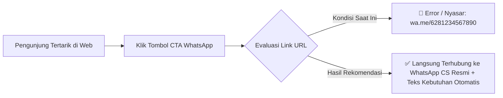
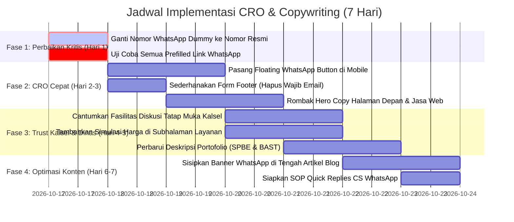

# LAPORAN AUDIT MARKETING COPYWRITING & CONVERSION RATE OPTIMIZATION (CRO)
**Website:** [MarketingCode.ID](https://marketingcode.id/)  
**Basis Data:** Live Render via Headless Playwright (14 URL Publik dari `sitemap.xml`)  
**Metodologi:** Framework Resmi Skill `copywriting` & `cro` (via [skills.sh](https://skills.sh/))  
**Target Pasar Utama:**  
1. Pelaku Usaha Mikro, Kecil, dan Menengah (UMKM) lokal di Kalimantan Selatan & sekitarnya.  
2. Pejabat Pengadaan / PPTK / Pimpinan Instansi Dinas & Kantor Pemerintahan Daerah di Kalimantan Selatan.  
**Tujuan Konversi Utama (Primary Conversion Goal):** Membimbing pengunjung untuk langsung berkonsultasi atau melakukan pemesanan via WhatsApp (*Click-to-WhatsApp Funnel*).  
**Tanggal Audit:** 17 Oktober 2026  

---

## DAFTAR ISI
1. [Kerangka Kerja Metodologi (Skills Framework)](#1-kerangka-kerja-metodologi-skills-framework)
2. [Temuan Kritis & Kebocoran Konversi Terbesar (Critical Blunder)](#2-temuan-kritis--kebocoran-konversi-terbesar-critical-blunder)
3. [Diagnosa Strategis: UMKM & Instansi Kalimantan Selatan](#3-diagnosa-strategis-umkm--instansi-kalimantan-selatan)
   - 3.1. Penyakit Jargon Programmer vs Bahasa Pelanggan Lokal
   - 3.2. Positioning untuk Instansi Pemerintah: Kepatuhan SPBE & Akuntabilitas BAST
   - 3.3. Hambatan Konversi (Friction) pada Formulir vs WhatsApp Langsung
   - 3.4. Ketiadaan Elemen Pendukung Transaksi Lokal (Tatap Muka & Simulasi Biaya)
4. [Audit Detail Copywriting & CRO Per Halaman (14 Halaman Publik)](#4-audit-detail-copywriting--cro-per-halaman-14-halaman-publik)
   - [Halaman 1: Beranda / Homepage (`/`)](#halaman-1-beranda--homepage-)
   - [Halaman 2: Jasa Pembuatan Website (`/jasa-pembuatan-website`)](#halaman-2-jasa-pembuatan-website-jasa-pembuatan-website)
   - [Halaman 3: Jasa Aplikasi Mobile (`/jasa-pembuatan-aplikasi-mobile`)](#halaman-3-jasa-aplikasi-mobile-jasa-pembuatan-aplikasi-mobile)
   - [Halaman 4: Jasa Iklan Meta Ads (`/jasa-iklan-meta-ads`)](#halaman-4-jasa-iklan-meta-ads-jasa-iklan-meta-ads)
   - [Halaman 5: Digital Marketing (`/digital-marketing`)](#halaman-5-digital-marketing-digital-marketing)
   - [Halaman 6: Video Editing & Motion Ads (`/video-editing`)](#halaman-6-video-editing--motion-ads-video-editing)
   - [Halaman 7: Indeks Portofolio (`/portfolio`)](#halaman-7-indeks-portofolio-portfolio)
   - [Halaman 8: Indeks Blog & Edukasi (`/blog`)](#halaman-8-indeks-blog--edukasi-blog)
   - [Halaman 9: Studi Kasus Si Wadai - DPRD (`/portfolio/si-wadai-aspirasi-aduan-masyarakat`)](#halaman-9-studi-kasus-si-wadai---dprd-portfoliosi-wadai-aspirasi-aduan-masyarakat)
   - [Halaman 10: Studi Kasus Si Akoor - Presensi ASN (`/portfolio/si-akoor-presensi-kinerja-pegawai`)](#halaman-10-studi-kasus-si-akoor---presensi-asn-portfoliosi-akoor-presensi-kinerja-pegawai)
   - [Halaman 11: Studi Kasus Si Ketuk Pintu - Buku Tamu OPD (`/portfolio/si-ketuk-pintu-sistem-kunjungan-tamu`)](#halaman-11-studi-kasus-si-ketuk-pintu---buku-tamu-opd-portfoliosi-ketuk-pintu-sistem-kunjungan-tamu)
   - [Halaman 12: Artikel Blog Katalog Online WhatsApp (`/blog/cara-membuat-katalog-produk-online-terhubung-whatsapp`)](#halaman-12-artikel-blog-katalog-online-whatsapp-blogcara-membuat-katalog-produk-online-terhubung-whatsapp)
   - [Halaman 13: Artikel Blog Meta Ads vs Landing Page (`/blog/iklan-meta-ads-langsung-whatsapp-vs-landing-page`)](#halaman-13-artikel-blog-meta-ads-vs-landing-page-blogiklan-meta-ads-langsung-whatsapp-vs-landing-page)
   - [Halaman 14: Artikel Blog Perlukah UMKM Punya Web? (`/blog/apakah-umkm-perlu-website-sendiri`)](#halaman-14-artikel-blog-perlukah-umkm-punya-web-blogapakah-umkm-perlu-website-sendiri)
5. [Arsitektur Konversi WhatsApp: Matriks Pesan Otomatis (Prefilled Text)](#5-arsitektur-konversi-whatsapp-matriks-pesan-otomatis-prefilled-text)
6. [Rekomendasi Widget Sticky Mobile (Kode Siap Pasang)](#6-rekomendasi-widget-sticky-mobile-kode-siap-pasang)
7. [Roadmap Eksekusi Prioritas 7 Hari](#7-roadmap-eksekusi-prioritas-7-hari)

---

## 1. Kerangka Kerja Metodologi (Skills Framework)

Audit ini dieksekusi secara ketat mengacu pada standar dua skill industri yang diinstal dari [skills.sh](https://skills.sh/):

### A. Metodologi `copywriting` (v2.3.1)
1. **Clarity Over Cleverness:** Kejelasan pesan mengalahkan permainan kata kreatif. Pengunjung harus paham dalam 5 detik apa yang ditawarkan dan apa dampaknya bagi mereka.
2. **Benefits Over Features:** Mengubah penjelasan fitur ("kami memakai Next.js & Supabase") menjadi hasil nyata bagi klien ("website cepat diakses pelanggan di pelosok dan data aman anti-hilang").
3. **Customer Language Matching:** Kosakata harus mencerminkan cara bicara UMKM (omzet, hemat waktu, anti-ribet, pembeli langsung chat) dan cara bicara birokrasi pemerintahan (SPBE, akuntabilitas, BAST, TPP, tertib administrasi).
4. **Eliminasi AI Tells:** Membuang pola klise AI seperti:
   - *Contrast reveals* ("Bukan sekadar X, tapi Y").
   - *Negation lists* ("Tanpa ribet, tanpa drama, tanpa mahal").
   - *Buzzword kosong* ("revolusioner", "seamless", "power of", "tingkatkan ke level berikutnya").
   - *Em dash* (—) berlebihan pada judul singkat.
5. **Formula CTA Bernilai Tinggi:** Mengganti CTA pasif (*"Submit"*, *"Pelajari Lebih Lanjut"*, *"Mulai Konsultasi"*) dengan formula:  
   `[Kata Kerja Aksi] + [Apa yang Didapatkan Pengunjung] + [Penurun Risiko/Gratis]`.

### B. Metodologi `cro` (v2.0.3)
1. **Value Proposition Hierarchy:** Evaluasi apakah pesan *above-the-fold* langsung menjawab 3 pertanyaan dasar: *Apa ini? Untuk siapa? Mengapa harus memilih Anda dibanding agensi lain?*
2. **CTA Visibility & Placement:** Memastikan tombol WhatsApp selalu terlihat tanpa harus scroll panjang (*above the fold*, *mid-content*, *bottom banner*, dan *mobile sticky*).
3. **Trust Signals & Social Proof:** Penempatan testimoni nyata, bukti visual pengerjaan, dan legalitas formal.
4. **Objection Handling:** Menangani ketakutan terbesar UMKM (takut mahal, tidak mengerti koding, takut ditinggal setelah web selesai) dan ketakutan dinas (takut kena temuan audit BPK/Inspektorat).
5. **Friction Removal:** Memangkas formulir rumit dan membuang link rusak/dummy.

---

## 2. Temuan Kritis & Kebocoran Konversi Terbesar (Critical Blunder)



### 🚨 Temuan Fatal: Seluruh Tombol WhatsApp Menggunakan Nomor Dummy `6281234567890`
Dari pembacaan kode DOM secara live melalui Playwright, **setiap tombol CTA di seluruh website production mengarah ke nomor palsu:**
```html
<a href="https://wa.me/6281234567890?text=Halo%20MarketingCode%20ID...">Konsultasi via WhatsApp</a>
```
* **Status:** **Darurat Paling Tinggi (Conversion Blocker 100%)**
* **Dampak Bisnis:** Pengunjung yang datang dari iklan berbayar (Meta Ads/Google Ads) atau pencarian organik Google yang berniat membeli **pasti gagal menghubungi admin**. Semua pengeluaran marketing saat ini bocor di titik penutupan (*closing gate*).
* **Solusi Segera:** Buat satu file konfigurasi terpusat atau environment variable `NEXT_PUBLIC_WHATSAPP_NUMBER` yang memuat nomor WhatsApp resmi agensi dengan format internasional (`628xxxxxxxxxx`).

---

## 3. Diagnosa Strategis: UMKM & Instansi Kalimantan Selatan

### 3.1. Penyakit Jargon Programmer vs Bahasa Pelanggan Lokal
Website MarketingCode.ID memiliki visual modern dan performa sangat cepat, namun di halaman layanan utama terjebak dalam gaya bahasa *developer-centric*.

| Kalimat Asli di Layar Saat Ini | Diagnosa Skill Copywriting | Rekomendasi Bahasa Pelanggan (UMKM) |
|---|---|---|
| *"Supabase Managed PostgreSQL & Drizzle ORM"* | Jargon murni database. UMKM tidak mengerti dan tidak peduli apa itu Drizzle ORM. | *"Penyimpanan data toko Anda terjamin aman di cloud, tidak takut data hilang, dan bisa dibuka dari HP kapan saja."* |
| *"Tracking CAPI server-side anti-kebocoran iOS 14+"* | Istilah teknis tracking iklan yang terlalu rumit bagi pemilik usaha kuliner atau ritel. | *"Setiap rupiah biaya iklan terlacak akurat: Anda tahu pasti iklan mana yang benar-benar menghasilkan chat orderan asli."* |
| *"Single Codebase Android & iOS dengan Flutter"* | Bahasa rekayasa perangkat lunak internal. | *"Satu kali pembuatan, aplikasi Anda langsung bisa dipasang di HP Android maupun iPhone tanpa biaya ganda."* |
| *"100% Hak Akses Repositori GitHub"* | Hak akses repositori hanya relevan jika klien memiliki programmer internal. | *"Website 100% menjadi milik Anda seutuhnya. Tanpa biaya sewa bulanan dan tanpa ketergantungan sepihak."* |

### 3.2. Positioning untuk Instansi Pemerintah: Kepatuhan SPBE & Akuntabilitas BAST
MarketingCode.ID memiliki portofolio instansi yang luar biasa: **Si Wadai (DPRD Kabupaten)**, **Si Akoor (Presensi & Kinerja ASN)**, dan **Si Ketuk Pintu (Buku Tamu Dinas/OPD)**.  
Namun, deskripsi portofolio tersebut saat ini hanya memamerkan: *React 19, React Router 7, Zod, Winston, Geolocation API*.
* Pejabat Pembuat Komitmen (PPK) atau PPTK dinas tidak bertanggung jawab kepada library koding; mereka bertanggung jawab pada **Inspektorat dan BPK**.
* Yang dicari dinas adalah:
  1. **Kesesuaian SPBE (Sistem Pemerintahan Berbasis Elektronik)**.
  2. **Kelengkapan Dokumen Pengadaan:** Surat Perjanjian Kerja (SPK), Berita Acara Pemeriksaan Hasil Pekerjaan (BAPHP), dan Berita Acara Serah Terima (BAST).
  3. **Legalitas Pajak:** Faktur Pajak PPh 22/23 dan PPN yang sah, serta kemampuan transaksi via SIPLah / LPSE / e-Katalog bila diperlukan.
  4. **Bimbingan Teknis (Bimtek):** Pendampingan dan pelatihan langsung untuk staf operator kantor sampai mahir.

### 3.3. Hambatan Konversi (Friction) pada Formulir vs WhatsApp
Di bagian bawah homepage terdapat form konsultasi:
* Mengapa meminta **"Alamat Email Bisnis"**? Karakter UMKM di Kalimantan Selatan jarang mengecek email harian mereka. Mereka 99% aktif di WhatsApp.
* Mengharuskan pengisian email sebelum membuka WhatsApp menambahkan friksi psikologis (*lead drop-off*).
* **Solusi:** Ganti field email menjadi **Nomor WhatsApp**, atau ganti tombol form dengan tombol direct WhatsApp 1-klik.

### 3.4. Ketiadaan Elemen Pendukung Transaksi Lokal
* **Jaminan Tatap Muka (Offline Consultation):** Klien daerah sangat menghargai pertemuan langsung (*"bisa ketemuan di warung kopi atau kantor dinas"*). Belum ada pernyataan: *"Tim kami berbasis di Kalimantan Selatan dan siap hadir untuk presentasi/diskusi tatap muka di Kandangan, Rantau, Barabai, Amuntai, Banjarmasin, Banjarbaru, dan sekitarnya."*
* **Transparansi Harga pada Halaman Layanan:** Hanya homepage yang memiliki tabel harga. Halaman `/jasa-pembuatan-website` tidak memiliki daftar paket sama sekali, sehingga calon klien menduga biayanya sangat mahal.

---

## 4. Audit Detail Copywriting & CRO Per Halaman (14 Halaman Publik)

---

### Halaman 1: Beranda / Homepage (`https://marketingcode.id/`)

#### A. Data Riil Hasil Render Headless Browser
* **Judul Utama (H1):** `Software House & Digital Agency Kalimantan Selatan`
* **Subheadline:** `Bangun website modern, aplikasi mobile, dan strategi digital marketing berbasis hasil nyata untuk pertumbuhan bisnis Anda di Kalimantan Selatan dan seluruh Indonesia.`
* **CTA Utama:** `Konsultasi via WhatsApp` (mengarah ke `wa.me/6281234567890`) dan `Lihat Portofolio`.
* **Section yang Tampil:**
  - Stats: `99.8% Uptime SLA`, `30+ Proyek Berhasil`, `100% Kepemilikan Kode`.
  - Flagship Solutions: Landing Page Kilat, Enterprise CMS (Next.js 16), Flutter Mobile App.
  - Growth: Digital Marketing (+320% ROI, CAPI Server-side), Video Editing (Hook 3 Detik).
  - Portofolio Ringkas: Si Wadai, Si Akoor, Si Ketuk Pintu.
  - Paket Harga: Starter UMKM (Rp 4.9jt), Business Pro (Rp 12.5jt), Enterprise (Rp 28jt+).
  - Alur Kerja: 3 Langkah (Discovery, Desain & Koding, Peluncuran).
  - FAQ: 3 Pertanyaan umum.
  - Form Kontak di Footer.

#### B. Diagnosa Berdasarkan Skill `copywriting` & `cro`
1. **Headline (H1):** Istilah *"Software House & Digital Agency"* adalah bahasa label perusahaan, bukan nilai bagi pelanggan (*Clarity over Cleverness*). UMKM di Barabai atau Martapura mencari *"Jasa Bikin Website Toko"* atau *"Jasa Iklan Online"*.
2. **Paket Harga Starter (Rp 4.9jt):** Angka Rp 4.9jt untuk paket termurah UMKM dapat menjadi *barrier-to-entry* yang terlalu tinggi bagi pedagang pemula. Di blog, Anda menyebutkan website UMKM bisa mulai dari Rp 1 jutaan. Inkonsistensi ini membuat UMKM langsung mundur.
3. **Form Footer:** Meminta email bisnis dan pesan panjang, padahal target akhir adalah mengalihkan ke WhatsApp.

#### C. Rekomendasi Perbaikan Copywriting (Before vs After)

* **Hero Headline (H1):**
  * ❌ *Teks Asli:* `Software House & Digital Agency Kalimantan Selatan`
  * ✅ *Rekomendasi Baru:* `Jasa Pembuatan Website, Aplikasi Mobile & Iklan Digital di Kalimantan Selatan`
* **Hero Subheadline:**
  * ❌ *Teks Asli:* `Bangun website modern, aplikasi mobile, dan strategi digital marketing berbasis hasil nyata untuk pertumbuhan bisnis Anda di Kalimantan Selatan dan seluruh Indonesia.`
  * ✅ *Rekomendasi Baru:* `Bantu bisnis UMKM kebanjiran orderan WhatsApp dan bantu instansi pemerintahan mendigitalkan layanan publik secara transparan. Tim lokal siap diskusi tatap muka di wilayah Kalsel.`
* **Hero CTA Button:**
  * ❌ *Teks Asli:* `Konsultasi via WhatsApp`
  * ✅ *Rekomendasi Baru:* `🟢 Konsultasi Gratis via WhatsApp (Respon Cepat)`
* **Tambahan Microcopy di Bawah CTA:**
  * ✅ *Tambahkan:* `⚡ Konsultasi awal tanpa biaya • Siap pertemuan tatap muka di Kalsel • Bergaransi`

---

### Halaman 2: Jasa Pembuatan Website (`https://marketingcode.id/jasa-pembuatan-website`)

#### A. Data Riil Hasil Render Headless Browser
* **Judul Utama (H1):** `Jasa Pembuatan Website & Sistem Informasi Profesional di Kalimantan Selatan`
* **Subheadline:** `Bangun kredibilitas bisnis dan efisiensi kerja instansi Anda dengan website yang cepat, aman, mobile-friendly, dan teroptimasi SEO. Melayani wilayah Kandangan (Hulu Sungai Selatan), Banua Enam, Banjarmasin, Banjarbaru, dan seluruh Indonesia.`
* **Section yang Tampil:**
  - 4 Solusi Sektor (Sistem Informasi Instansi/Dinas, Website Bisnis Spesifik, Company Profile, Landing Page Promosi).
  - Standar Kualitas (Next.js & Laravel, On-Page SEO Friendly, Dashboard Admin Aman).
  - 4 Tahapan Pengerjaan.
  - Area Layanan Kalsel (Kandangan HSS, Rantau, Barabai, Amuntai, Balangan, Tabalong, Banjarbaru, Banjarmasin).
  - Cross-sell Meta Ads & Mobile App.
  - FAQ (Biaya, Lama Pengerjaan, Domain & Hosting).

#### B. Diagnosa Berdasarkan Skill `copywriting` & `cro`
1. **Kekuatan:** Penyebutan nama-nama kota di Banua Enam dan Kalsel sangat kuat untuk relevansi lokal dan SEO lokal.
2. **Kelemahan Kritis (CRO):** **Halaman ini sama sekali tidak memiliki tabel atau simulasi harga!** FAQ menyebut *"Berapa biaya pembuatan website di Kandangan..."*, tetapi jawaban di dalam halaman tidak transparan. Pengunjung yang tidak melihat angka akan berasumsi biayanya puluhan juta.
3. **Ketiadaan Mockup Visual Dashboard:** Disebutkan *"Dashboard Admin Mudah Dikelola"*, namun tidak ada gambar/tangkapan layar dashboard HP untuk meyakinkan calon klien yang gaptek bahwa mereka bisa memakainya sendiri.

#### C. Rekomendasi Perbaikan Copywriting (Before vs After)

* **Hero Subheadline:**
  * ❌ *Teks Asli:* `Bangun kredibilitas bisnis dan efisiensi kerja instansi Anda dengan website yang cepat, aman, mobile-friendly, dan teroptimasi SEO...`
  * ✅ *Rekomendasi Baru:* `Tingkatkan omzet toko Anda dengan website yang langsung terhubung ke order WhatsApp, atau hadirkan portal dinas yang tertib administrasi dan lolos uji SPBE. 100% hak milik Anda tanpa sistem sewa.`
* **Penambahan Section Simulasi Investasi Paket (Wajib Ditambahkan):**
  ```markdown
  ### Pilihan Paket Website Sesuai Kebutuhan Anda
  1. **Paket Landing Page Promosi (Mulai Rp 1,5 Juta):**
     - 1 Halaman penjualan fokus konversi tinggi.
     - Sangat cocok untuk produk kuliner, fashion, jasa servis, atau pendamping iklan Meta Ads.
     - Terhubung langsung ke WhatsApp & terpasang Pixel. Pengerjaan 3-5 hari.
  2. **Paket Katalog Produk & Bisnis Lokal (Mulai Rp 3,5 Juta):**
     - Tampilan katalog lengkap dengan tombol "Order via WhatsApp" otomatis.
     - Admin mandiri: ganti foto, harga, dan stok langsung dari smartphone.
     - Gratis domain .com & hosting 1 tahun + garansi maintenance.
  3. **Paket Sistem Informasi Instansi & Portal Custom (Sesuai Kebutuhan):**
     - e-Office, buku tamu QR, pelaporan aduan masyarakat, integrasi database.
     - Dilengkapi BAST, dokumen pengadaan resmi, dan pelatihan operator (Bimtek) di kantor Anda.
  ```
* **CTA WhatsApp:**
  * ❌ *Teks Asli:* `Konsultasi via WhatsApp`
  * ✅ *Rekomendasi Baru:* `💬 Tanya Estimasi Biaya Website via WhatsApp`

---

### Halaman 3: Jasa Aplikasi Mobile (`https://marketingcode.id/jasa-pembuatan-aplikasi-mobile`)

#### A. Data Riil Hasil Render Headless Browser
* **Judul Utama (H1):** `Jasa Pembuatan Aplikasi Mobile Android & iOS Profesional`
* **Subheadline:** `Wujudkan aplikasi mobile berkinerja tinggi untuk layanan publik pemerintah, sistem informasi instansi, maupun operasional bisnis komersial Anda di Kalimantan Selatan dan seluruh Indonesia.`
* **Section yang Tampil:**
  - 3 Solusi (Layanan Publik/E-Gov, Internal Presensi/Kinerja Geotagging, Komersial/Booking Layanan).
  - Keunggulan Teknis (Lintas Platform Android & iOS, Integrasi Web Admin & REST API, Pendampingan Publikasi Play Store & App Store).
  - Cross-sell Website.
  - FAQ (Kompatibilitas Android & iPhone, Dashboard admin, Diskusi langsung di Kalsel).

#### B. Diagnosa Berdasarkan Skill `copywriting` & `cro`
1. **Keberatan Utama (Objection Handling):** Calon klien takut akan dua hal besar saat membuat aplikasi:
   - *"Apakah proses upload ke Google Play Store dan Apple App Store ribet?"*
   - *"Berapa biaya perpanjangan server dan lisensi toko aplikasinya?"*
2. Halaman ini sudah menyebut pendampingan publikasi, tetapi belum secara tegas memberikan garansi: *"Aplikasi dijamin lolos verifikasi Play Store / App Store atau uang kembali/kami revisi sampai tayang"*.

#### C. Rekomendasi Perbaikan Copywriting (Before vs After)

* **Hero Subheadline:**
  * ❌ *Teks Asli:* `Wujudkan aplikasi mobile berkinerja tinggi untuk layanan publik pemerintah, sistem informasi instansi, maupun operasional bisnis komersial Anda di Kalimantan Selatan dan seluruh Indonesia.`
  * ✅ *Rekomendasi Baru:* `Miliki aplikasi Android dan iPhone resmi atas nama bisnis atau instansi Anda. Kami tangani semuanya dari rancang alur, pembuatan sistem, hingga terbit resmi di Google Play Store dan App Store.`
* **Section Jaminan (Risk Reversal):**
  * ✅ *Tambahkan:* `🛡️ Garansi Publikasi: Kami kawal proses peninjauan Google & Apple hingga aplikasi Anda benar-benar bisa di-download masyarakat luas.`
* **CTA WhatsApp:**
  * ❌ *Teks Asli:* `Konsultasi via WhatsApp`
  * ✅ *Rekomendasi Baru:* `📲 Diskusikan Rencana Aplikasi Anda via WhatsApp`

---

### Halaman 4: Jasa Iklan Meta Ads (`https://marketingcode.id/jasa-iklan-meta-ads`)

#### A. Data Riil Hasil Render Headless Browser
* **Judul Utama (H1):** `Jasa Kelola Iklan Meta Ads (Facebook & Instagram) Berbasis Konversi & Prospek`
* **Subheadline:** `Berhenti membakar anggaran iklan hanya untuk klik dan tayangan tanpa hasil. Kami membantu bisnis Anda mendatangkan chat calon pembeli potensial ke WhatsApp dan meningkatkan penjualan melalui manajemen kampanye Meta Ads yang terukur.`
* **Kutipan Kendala Nyata (Asli):**
  - *Anggaran Iklan Habis Banyak Tapi Minim Chat Masuk ke WhatsApp (Hanya menekan tombol "Promosikan/Boost Post" di aplikasi).*
  - *Prospek yang Masuk Kurang Berkualitas (Hanya Sekadar Tanya).*
  - *Tidak Punya Waktu Mengurus Teknis Ads Manager & Materi Video Iklan.*
* **Section Strategi:** Click-to-WhatsApp (CTWA), Riset Audiens & Pixel, Materi Iklan Reels/Stories, Evaluasi Berkala.

#### B. Diagnosa Berdasarkan Skill `copywriting` & `cro`
1. **Nilai Copywriting:** Halaman ini memiliki **copywriting terbaik dan paling persuasif** di antara seluruh halaman layanan! Penggunaan analogi "menekan tombol Boost Post membuat anggaran habis" adalah cerminan masalah riil UMKM (*Customer Language Matching*).
2. **Kekurangan CRO:**
   - Belum ada studi kasus hasil iklan nyata (misal: *"Bisnis Toko Kuliner di Banjarbaru: Mendapatkan 450+ chat WhatsApp dengan biaya rata-rata Rp 2.200 per chat"*).
   - Pengunjung tidak tahu berapa minimal budget untuk mulai iklan.

#### C. Rekomendasi Perbaikan Copywriting (Before vs After)

* **Tambahan Kotak Transparansi Modal Iklan:**
  ```markdown
  ### Berapa Modal untuk Mulai Beriklan?
  - **Budget Iklan ke Meta:** Mulai dari Rp 50.000 / hari (Rp 1,5 juta/bulan) yang langsung dibayarkan ke akun iklan Anda.
  - **Jasa Kelola Agensi:** Sudah termasuk riset target pasar lokal Kalsel, pembuatan materi video/desain iklan, copywriting penawaran, dan pemantauan performa harian agar terhindar dari boncos.
  ```
* **CTA Button:**
  * ❌ *Teks Asli:* `Konsultasi via WhatsApp`
  * ✅ *Rekomendasi Baru:* `📊 Dapatkan Audit Akun Iklan Gratis via WhatsApp`

---

### Halaman 5: Digital Marketing (`https://marketingcode.id/digital-marketing`)

#### A. Data Riil Hasil Render Headless Browser
* **Judul Utama (H1):** `Digital Marketing Berbasis ROI & Konversi Omzet`
* **Subheadline:** `Hentikan pemborosan budget iklan tanpa hasil terukur. Kami merancang strategi funnel pemasaran presisi melalui Meta Ads, Google Search, SEO teknis, dan tracking CAPI server-side anti-bocor.`
* **Fitur yang Ditampilkan:** Meta Ads (CAPI, Lookalike), Google Ads & SEO (Buying intent, Quality Score), Funnel & CRO Optimization (Heatmap, Session recording), Live Looker Studio Analytics.
* **CTA:** `Audit Akun Iklan Gratis` dan `Mulai Konsultasi via WhatsApp`.

#### B. Diagnosa Berdasarkan Skill `copywriting` & `cro`
1. **Paling Padat Jargon:** Halaman ini memiliki tingkat kepadatan jargon teknis tertinggi (*CAPI server-side gateway, lookalike, quality score, heatmap recording, Looker Studio 24/7*).
2. **Kesenjangan Target:** Pelaku UMKM lokal tidak memahami istilah-istilah ini. Halaman ini lebih mirip dokumen proposal teknis untuk perusahaan multinasional daripada halaman penawaran untuk pasar Kalimantan.

#### C. Rekomendasi Perbaikan Copywriting (Before vs After)

* **Hero Headline & Subheadline:**
  * ❌ *Teks Asli:* `Digital Marketing Berbasis ROI & Konversi Omzet. Hentikan pemborosan budget iklan tanpa hasil terukur. Kami merancang strategi funnel pemasaran presisi melalui Meta Ads, Google Search, SEO teknis, dan tracking CAPI server-side anti-bocor.`
  * ✅ *Rekomendasi Baru:* `Strategi Pemasaran Digital Lengkap: Dari Iklan Google Hingga Media Sosial yang Menghasilkan Orderan Nyata. Jangan biarkan biaya promosi terbuang tanpa hasil. Kami bantu bisnis Anda ditemukan calon pembeli yang siap belanja di Google dan media sosial, lalu mengarahkannya langsung ke WhatsApp Anda.`
* **Penyederhanaan Value Props:**
  * ❌ *Teks Asli:* `Dashboard Realtime Looker Studio`
  * ✅ *Rekomendasi Baru:* `Laporan Transparan yang Mudah Dipahami: Anda bisa memantau dengan jelas setiap rupiah biaya iklan dan berapa jumlah orderan yang masuk setiap minggunya.`

---

### Halaman 6: Video Editing & Motion Ads (`https://marketingcode.id/video-editing`)

#### A. Data Riil Hasil Render Headless Browser
* **Judul Utama (H1):** `Konten Video Kreatif dengan Retensi & Hook Tinggi`
* **Subheadline:** `Tangkap perhatian audiens dalam 3 detik pertama. Kami memproduksi materi video iklan vertikal untuk TikTok, Instagram Reels, dan YouTube Shorts yang dirancang spesifik untuk meningkatkan konversi dan engagement.`
* **Fitur:** Short-Form Ads 9:16, Company Showreel, Motion Graphics, Social Media Content Retainer (15-30 video/bulan).
* **CTA:** `Diskusikan Konsep Video`, `Chat Konsultasi Video`.

#### B. Diagnosa Berdasarkan Skill `copywriting` & `cro`
1. **Masalah Fatal Visual (Show, Don't Tell):** Halaman jasa video editing **tetapi tidak ada satu pun video yang bisa diputar!** Calon klien tidak akan pernah membeli jasa video hanya dengan membaca tulisan teks dan kartu statis.
2. **Kekhawatiran UMKM (Objection):** Pemilik toko sering merasa tidak punya kamera bagus: *"Kamera saya cuma HP Android biasa, apa bisa diedit jadi bagus?"*. Copywriting harus menenangkan kekhawatiran ini.

#### C. Rekomendasi Perbaikan Copywriting (Before vs After)

* **Hero Subheadline:**
  * ❌ *Teks Asli:* `Tangkap perhatian audiens dalam 3 detik pertama. Kami memproduksi materi video iklan vertikal untuk TikTok, Instagram Reels, dan YouTube Shorts yang dirancang spesifik untuk meningkatkan konversi dan engagement.`
  * ✅ *Rekomendasi Baru:* `Ubah penonton media sosial menjadi pembeli setia. Cukup kirim video rekaman dari kamera HP Anda, tim kami yang menyulapnya menjadi video iklan vertikal berkualitas tinggi lengkap dengan teks animasi, efek suara, dan pesan jualan yang memikat.`
* **CTA WhatsApp:**
  * ❌ *Teks Asli:* `Diskusikan Konsep Video`
  * ✅ *Rekomendasi Baru:* `🎬 Kirim Contoh Bahan Video & Tanya Harga via WhatsApp`

---

### Halaman 7: Indeks Portofolio (`https://marketingcode.id/portfolio`)

#### A. Data Riil Hasil Render Headless Browser
* **Judul Utama (H1):** `Hasil Kerja Nyata yang Telah Beroperasi`
* **Subheadline:** `Setiap proyek dimulai dari masalah bisnis yang spesifik. Buka studi kasusnya untuk melihat tantangan, solusi, dan teknologi yang kami pakai.`
* **Proyek yang Tercantum:** Si Wadai (DPRD Kabupaten), Si Akoor (Instansi Pemerintah), Si Ketuk Pintu (Kantor Dinas/OPD).
* **CTA:** `Diskusi via WhatsApp`.

#### B. Diagnosa Berdasarkan Skill `copywriting` & `cro`
1. **Bias Portofolio:** Semua studi kasus berasal dari kantor dinas/pemerintah. Tidak ada studi kasus UMKM komersial. Akibatnya, pengusaha UMKM yang masuk ke halaman ini merasa minder: *"Wah, agensi ini cuma melayani instansi besar dengan anggaran ratusan juta, bukan untuk toko saya."*
2. **Kategori Kosong:** Tab "Mobile Application", "Digital Marketing", dan "Video Production" menampilkan 0 item saat difilter. Ini menurunkan kredibilitas agensi.

#### C. Rekomendasi Perbaikan Copywriting (Before vs After)

* **Hero Subheadline:**
  * ❌ *Teks Asli:* `Setiap proyek dimulai dari masalah bisnis yang spesifik...`
  * ✅ *Rekomendasi Baru:* `Mulai dari sistem digitalisasi layanan publik di Kalimantan Selatan hingga website penjualan bisnis lokal. Lihat bagaimana solusi kami mempermudah operasional dan mendongkrak hasil nyata bagi klien.`
* **Perbaikan UX/CRO:**
  * Tambahkan 1-2 kartu portofolio UMKM (misal: "Website Toko Katalog WhatsApp" atau "Landing Page Kuliner Lokal") atau sembunyikan tab kategori yang belum memiliki item proyek.

---

### Halaman 8: Indeks Blog & Edukasi (`https://marketingcode.id/blog`)

#### A. Data Riil Hasil Render Headless Browser
* **Judul Utama (H1):** `Wawasan Digital untuk Keputusan Bisnis yang Lebih Tepat`
* **Subheadline:** `Panduan praktis seputar website, aplikasi mobile, dan iklan digital — ditulis dari pengalaman mengerjakan proyek klien.`
* **Daftar Artikel:** 3 Artikel edukasi UMKM dengan topik katalog WA, Meta Ads vs LP, dan website vs medsos.
* **CTA Bottom Banner:** `Punya Pertanyaan yang Belum Terjawab? Tanyakan langsung ke tim kami. Konsultasi awal gratis dan tanpa komitmen.`

#### B. Diagnosa Berdasarkan Skill `copywriting` & `cro`
1. **Kualitas Konten:** Indeks blog ini sangat menarik karena judul-judul artikelnya sangat relevan dengan keresahan harian pengusaha lokal.
2. **Kekurangan CRO:** Banner penutup di bagian bawah terlalu formal dan pasif (*"Punya Pertanyaan yang Belum Terjawab?"*).

#### C. Rekomendasi Perbaikan Copywriting (Before vs After)

* **Bottom Banner Copy:**
  * ❌ *Teks Asli:* `Punya Pertanyaan yang Belum Terjawab? Tanyakan langsung ke tim kami. Konsultasi awal gratis dan tanpa komitmen.`
  * ✅ *Rekomendasi Baru:* `Bingung Mau Mulai Digitalisasi Usaha dari Mana? Jangan ragu untuk berdiskusi santai. Ceritakan kendala jualan Anda saat ini, tim kami siap memberikan saran strategi yang paling hemat dan tepat sasaran.`
* **CTA Button:**
  * ❌ *Teks Asli:* `Diskusi via WhatsApp`
  * ✅ *Rekomendasi Baru:* `🟢 Tanya-Tanya Dulu via WhatsApp (Gratis)`

---

### Halaman 9: Studi Kasus Si Wadai - DPRD (`https://marketingcode.id/portfolio/si-wadai-aspirasi-aduan-masyarakat`)

#### A. Data Riil Hasil Render Headless Browser
* **Judul Utama (H1):** `Si Wadai — Platform Aspirasi & Aduan Masyarakat DPRD`
* **Subheadline:** `Platform layanan publik untuk menampung aspirasi dapil DPRD, aduan masyarakat berbasis peta (geolocation), dan survei IKM — lengkap dengan tiket pelacakan status dan dashboard admin rekapitulasi.`
* **Kutipan Masalah Asli:** *"Aspirasi dan aduan warga diterima lewat grup WhatsApp dan lisan sehingga mudah terlupa, tidak bisa diprioritaskan, sulit diverifikasi keberadaan lokusnya, dan masyarakat tidak bisa memantau perkapan aduannya. Rekapitulasi untuk rapat evaluasi pun manual."*
* **Tech Stack:** React 19, React Router 7, Drizzle ORM, PostgreSQL, Geolocation API, Zod.

#### B. Diagnosa Berdasarkan Skill `copywriting` & `cro`
1. **Penyusunan Masalah & Solusi:** Sangat terstruktur dan masuk akal. Masalah aduan tercecer di grup WA adalah kenyataan di banyak kantor pemerintahan daerah.
2. **Kelemahan Komunikasi Dinas:** Bagian "Tech Stack" memamerkan istilah koding yang tidak bernilai di mata sekretariat DPRD. Pejabat dinas membutuhkan jaminan bahwa sistem ini **memenuhi standar SPBE, menjamin kerahasiaan NIK warga sesuai UU PDP, dan siap diekspor menjadi laporan LKPJ resmi**.

#### C. Rekomendasi Perbaikan Copywriting (Before vs After)

* **Transformasi Tech Stack Menjadi "Keunggulan Sistem untuk Instansi":**
  * ❌ *Fokus Lama:* `React 19, Drizzle ORM, Zod, PostgreSQL`
  * ✅ *Fokus Baru Berorientasi Lembaga:*
    - 🏛️ **Kepatuhan SPBE:** Sesuai pedoman tata kelola layanan aspirasi publik pemerintahan berbasis elektronik.
    - 📍 **Verifikasi Geolocation GPS:** Memastikan lokasi aduan warga akurat dan mencegah laporan palsu/fiktif.
    - 📑 **Ekspor Laporan Rapat Paripurna:** Data aspirasi langsung terangkum rapi dalam format PDF/Excel resmi untuk bahan evaluasi masa sidang.
    - 🔒 **Keamanan Data Pribadi (UU PDP):** Perlindungan data NIK pelapor dengan enkripsi database berlapis.
* **CTA WhatsApp:**
  * ❌ *Teks Asli:* `Bangun Solusi Serupa`
  * ✅ *Rekomendasi Baru:* `🏛️ Jadwalkan Paparan & Diskusi Teknis via WhatsApp`

---

### Halaman 10: Studi Kasus Si Akoor - Presensi ASN (`https://marketingcode.id/portfolio/si-akoor-presensi-kinerja-pegawai`)

#### A. Data Riil Hasil Render Headless Browser
* **Judul Utama (H1):** `Si Akoor — Aplikasi Presensi & Kinerja Pegawai Berbasis Web`
* **Subheadline:** `Portal presensi pegawai multi-device (desktop/tablet/smartphone) dengan dashboard admin terpusat untuk memantau kehadiran dan kinerja pegawai secara real-time.`
* **Kutipan Masalah Asli:** *"Rekap presensi pegawai dilakukan manual dan tersebar di berbagai perangkat, sehingga pimpinan sulit memantau kedisiplinan secara akurat, data rawan dimanipulasi, dan penyusunan laporan kinerja bulanan memakan waktu berhari-hari."*
* **Tech Stack:** React 19, React Router 7, Drizzle ORM, PostgreSQL, Zod, Winston.

#### B. Diagnosa Berdasarkan Skill `copywriting` & `cro`
1. **Pemahaman Masalah:** Mengangkat poin krusial instansi: "titip absen manual" dan "penyusunan laporan kinerja bulanan yang memakan waktu berhari-hari".
2. **Kekurangan:** Belum menonjolkan integrasi dengan perhitungan pemotongan **TPP (Tambahan Penghasilan Pegawai)** yang menjadi beban utama bagian Kepegawaian (BKPSDM / Bagian Organisasi).

#### C. Rekomendasi Perbaikan Copywriting (Before vs After)

* **Hero Subheadline:**
  * ❌ *Teks Asli:* `Portal presensi pegawai multi-device (desktop/tablet/smartphone) dengan dashboard admin terpusat untuk memantau kehadiran dan kinerja pegawai secara real-time.`
  * ✅ *Rekomendasi Baru:* `Solusi Presensi & Pemantauan Kinerja ASN Anti-Manipulasi. Dilengkapi validasi titik GPS lokasi kantor, rekapitulasi otomatis kehadiran bulanan, dan laporan siap pakai sebagai dasar penetapan insentif kinerja.`
* **CTA WhatsApp:**
  * ❌ *Teks Asli:* `Bangun Solusi Serupa`
  * ✅ *Rekomendasi Baru:* `📋 Konsultasi Sistem Presensi Instansi via WhatsApp`

---

### Halaman 11: Studi Kasus Si Ketuk Pintu - Buku Tamu OPD (`https://marketingcode.id/portfolio/si-ketuk-pintu-sistem-kunjungan-tamu`)

#### A. Data Riil Hasil Render Headless Browser
* **Judul Utama (H1):** `Si Ketuk Pintu — Sistem Kunjungan Tamu & Buku Tamu Digital`
* **Subheadline:** `Aplikasi buku tamu digital dengan pengajuan kunjungan multi-langkah, token kunjungan berbasis QR Code, dan portal admin untuk verifikasi, penjadwalan ulang, hingga arsip permohonan.`
* **Kutipan Masalah Asli:** *"Proses kunjungan tamu ke kantor instansi masih manual: buku tamu fisik, tamu harus datang tanpa kepastian jadwal, petugas kesulitan memverifikasi dan melacak riwayat kunjungan, serta rekap data pengunjung untuk pelaporan memakan waktu lama dan rawan hilang."*
* **Tech Stack:** React 19, TypeScript, Tailwind CSS, html5-qrcode, jsPDF, Zod.

#### B. Diagnosa Berdasarkan Skill `copywriting` & `cro`
1. **Peluang Pasar Luas:** Solusi buku tamu QR Code ini sangat dibutuhkan tidak hanya oleh kantor dinas, melainkan juga kantor perusahaan sawit/tambang, rumah sakit daerah, perhotelan, dan perguruan tinggi di Kalsel.
2. **Kekurangan Copywriting:** Narasi masih terlalu terkungkung pada terminologi "kantor dinas/OPD", sehingga mengabaikan potensi pasar swasta/BUMN lokal.

#### C. Rekomendasi Perbaikan Copywriting (Before vs After)

* **Perluasan Target Pengguna:**
  * ✅ *Tambahkan Kotak Relevansi:*  
    *"Sistem Si Ketuk Pintu ini siap diimplementasikan untuk: Kantor Dinas & Pemda, Perusahaan Perkebunan & Pertambangan di Kalsel, Rumah Sakit Umum Daerah (RSUD), hingga Kampus dan Sekolah."*
* **CTA WhatsApp:**
  * ❌ *Teks Asli:* `Bangun Solusi Serupa`
  * ✅ *Rekomendasi Baru:* `🎟️ Minta Demo Buku Tamu QR Code via WhatsApp`

---

### Halaman 12: Artikel Blog Katalog Online WhatsApp (`https://marketingcode.id/blog/cara-membuat-katalog-produk-online-terhubung-whatsapp`)

#### A. Data Riil Hasil Render Headless Browser
* **Judul Utama (H1):** `Cara Membuat Katalog Produk Online yang Langsung Terhubung ke Order WhatsApp`
* **Kutipan Asli:** *"Capek kirim foto produk satu-satu tiap ada yang chat? Yuk, simak cara membuat katalog produk online yang langsung nyambung ke order WhatsApp biar jualan makin laris!"*
* **Struktur Tulisan:** Sangat baik, mengupas perbandingan cara manual vs website katalog dan menampilkan contoh format chat order WhatsApp.

#### B. Diagnosa Berdasarkan Skill `copywriting` & `cro`
1. **Tone of Voice:** Sempurna (*Situation B: Real Voice Present*). Nada tulisan santai, empatik terhadap rasa lelah pedagang online, dan solutif.
2. **Kebocoran CRO:** Pengunjung yang membaca artikel ini sudah memiliki *buying intent* tinggi untuk membuat katalog produk. Namun, **tidak ada tombol ajakan langsung di tengah artikel**. Pembaca yang selesai membaca poin 2 harus scrolling jauh ke bawah untuk mencari kontak.

#### C. Rekomendasi Perbaikan CRO (In-Article Callout Banner)

* **Sisipkan Banner Ajakan Tepat Setelah Poin 2:**
  ```markdown
  > 📦 **Ingin Punya Website Katalog Seperti Ini Tanpa Pusing Koding?**  
  > Tim MarketingCode ID siap membuatkan website katalog produk siap pakai lengkap dengan tombol order WhatsApp otomatis dalam 5-7 hari kerja.  
  > [👉 Konsultasikan Katalog Produk Usaha Anda via WhatsApp](https://wa.me/628XXXXXXXXXX?text=Halo%20MarketingCode%20ID%2C%20saya%20membaca%20artikel%20katalog%20produk%20dan%20ingin%20dibuatkan%20website%20katalog%20WhatsApp%20untuk%20usaha%20saya)
  ```

---

### Halaman 13: Artikel Blog Meta Ads vs Landing Page (`https://marketingcode.id/blog/iklan-meta-ads-langsung-whatsapp-vs-landing-page`)

#### A. Data Riil Hasil Render Headless Browser
* **Judul Utama (H1):** `Iklan Meta Ads Langsung ke WhatsApp vs Pakai Landing Page: Mana Lebih Menguntungkan untuk UMKM?`
* **Kutipan Asli:** *"Berapa harganya kak? (begitu dikasih tahu harganya, langsung hilang). Lokasinya di mana? (padahal di teks iklan sudah ditulis jelas). Atau yang paling bikin elus dada: pas ditanya 'Halo kak, ada yang bisa dibantu?', orangnya malah jawab, 'Maaf kepencet.'"*

#### B. Diagnosa Berdasarkan Skill `copywriting` & `cro`
1. **Daya Tarik:** Kutipan "maaf kepencet" adalah *hook* psikologis yang luar biasa karena merupakan pengalaman traumatis hampir semua pengiklan pemula.
2. **Kekurangan CRO:** Pada tabel perbandingan simulasi hitung-hitungan biaya iklan, belum ada *lead capture* untuk menawarkan audit iklan gratis.

#### C. Rekomendasi Perbaikan CRO (Audit Offer Box)

* **Tambahkan Kotak Penawaran di Bawah Tabel Simulasi:**
  ```markdown
  ### 🔍 Apakah Iklan Anda Saat Ini Sering Boncos?
  Jangan biarkan anggaran promosi Anda terbuang percuma setiap hari. Kirimkan link materi iklan atau akun Instagram Anda, tim kami akan membedah strategi funnel iklan Anda secara gratis via WhatsApp!
  [📲 Klaim Bedah Iklan Gratis via WhatsApp](https://wa.me/628XXXXXXXXXX?text=Halo%20MarketingCode%20ID%2C%20saya%20mau%20konsultasi%20strategi%20iklan%20Meta%20Ads%20vs%20Landing%20Page%20untuk%20produk%20saya)
  ```

---

### Halaman 14: Artikel Blog Perlukah UMKM Punya Web? (`https://marketingcode.id/blog/apakah-umkm-perlu-website-sendiri`)

#### A. Data Riil Hasil Render Headless Browser
* **Judul Utama (H1):** `Sudah Punya Instagram & Shopee, Apakah UMKM Masih Perlu Website Sendiri?`
* **Kutipan Asli:** *"Jualan di media sosial dan marketplace itu sebenarnya mirip seperti kita menyewa lapak di mal milik orang lain... Beda cerita kalau Anda punya website sendiri. Ini ibarat ruko di atas tanah milik Anda sendiri."*

#### B. Diagnosa Berdasarkan Skill `copywriting` & `cro`
1. **Analogi Emas:** Analogi "Ngontrak Lapak di Mal vs Punya Ruko di Tanah Sendiri" adalah instrumen edukasi penjualan terbaik yang menjelaskan mengapa kepemilikan aset digital independen itu penting.
2. **Peluang Konversi:** Di akhir artikel, alih-alih hanya FAQ pasif, berikan penawaran paket awal yang terjangkau agar pembaca langsung mengambil keputusan pembelian.

#### C. Rekomendasi Perbaikan Copywriting (Closing Offer)

* **Penawaran Penutup Artikel:**
  ```markdown
  ### Mulai Miliki "Ruko Digital" Usaha Anda Sekarang!
  Bebas potongan komisi marketplace dan tidak takut akun disuspend sepihak. Dapatkan paket website toko online UMKM ramah anggaran dengan pengerjaan kilat.
  [🚀 Konsultasikan Website Toko Saya via WhatsApp](https://wa.me/628XXXXXXXXXX?text=Halo%20MarketingCode%20ID%2C%20saya%20tertarik%20bikin%20website%20ruko%20digital%20sendiri%20untuk%20usaha%20saya)
  ```

---

## 5. Arsitektur Konversi WhatsApp: Matriks Pesan Otomatis (Prefilled Text)

Salah satu prinsip terpenting dalam CRO WhatsApp adalah **menghilangkan beban berpikir calon klien saat pertama kali membuka obrolan**. Ketika tombol WhatsApp diklik, kolom chat harus sudah terisi draf pesan yang relevan dengan halaman yang sedang mereka buka:

| Lokasi Tombol di Website | Teks Tombol Baru (High-Converting CTA) | Parameter Link WhatsApp Otomatis (`wa.me`) |
|---|---|---|
| **Navbar Utama (Global)** | `🟢 Konsultasi Cepat (WA)` | `https://wa.me/628XXXXXXXXXX?text=Halo%20MarketingCode%20ID%2C%20saya%20ingin%20tanya-tanya%20layanan%20digital%20untuk%20usaha%2Finstansi%20saya.` |
| **Hero Homepage** | `🟢 Konsultasi Gratis via WhatsApp` | `https://wa.me/628XXXXXXXXXX?text=Halo%20MarketingCode%20ID%2C%20saya%20tertarik%20konsultasi%20layanan%20(Website%2FAplikasi%2FIklan)%20untuk%20wilayah%20Kalsel.` |
| **Jasa Pembuatan Website** | `💬 Tanya Estimasi Biaya Website` | `https://wa.me/628XXXXXXXXXX?text=Halo%20MarketingCode%20ID%2C%20saya%20ingin%20konsultasi%20estimasi%20biaya%20pembuatan%20website%20(Landing%20Page%20%2F%20Katalog%20Toko%20%2F%20Instansi).` |
| **Jasa Aplikasi Mobile** | `📲 Diskusikan Rencana Aplikasi` | `https://wa.me/628XXXXXXXXXX?text=Halo%20MarketingCode%20ID%2C%20saya%20ada%20rencana%20pembuatan%20aplikasi%20Android%2FiOS%20untuk%20(nama%20proyek).%20Bisa%20diskusi%20tahapannya%3F` |
| **Jasa Iklan Meta Ads** | `📊 Dapatkan Audit Akun Iklan Gratis` | `https://wa.me/628XXXXXXXXXX?text=Halo%20MarketingCode%20ID%2C%20saya%20mau%20konsultasi%20iklan%20Meta%20Ads%20agar%20chat%20WhatsApp%20orderan%20meningkat.%20Bisa%20bantu%20audit%20akun%20saya%3F` |
| **Jasa Video Editing** | `🎬 Kirim Bahan Video & Tanya Harga` | `https://wa.me/628XXXXXXXXXX?text=Halo%20tim%20video%20MarketingCode%20ID%2C%20saya%20punya%20video%20mentah%20dan%20ingin%20diedit%20menjadi%20iklan%20Reels%2FTikTok.%20Boleh%20tahu%20paket%20harganya%3F` |
| **Studi Kasus Si Wadai** | `🏛️ Jadwalkan Paparan Sistem Aspirasi` | `https://wa.me/628XXXXXXXXXX?text=Halo%20MarketingCode%20ID%2C%20kami%20dari%20instansi%20tertarik%20dengan%20sistem%20pelaporan%20seperti%20Si%20Wadai.%20Bisa%20jadwalkan%20diskusi%20%2F%20paparan%3F` |
| **Studi Kasus Si Akoor** | `📋 Konsultasi Sistem Presensi Instansi` | `https://wa.me/628XXXXXXXXXX?text=Halo%20MarketingCode%20ID%2C%20kami%20ingin%20konsultasi%20sistem%20presensi%20%26%20kinerja%20pegawai%20seperti%20Si%20Akoor.%20Boleh%20minta%20info%20detailnya%3F` |
| **Studi Kasus Si Ketuk Pintu** | `🎟️ Minta Demo Buku Tamu QR Code` | `https://wa.me/628XXXXXXXXXX?text=Halo%20MarketingCode%20ID%2C%20kami%20tertarik%20menerapkan%20buku%20tamu%20digital%20QR%20Code%20seperti%20Si%20Ketuk%20Pintu.%20Bisa%20kirimkan%20gambarannya%3F` |
| **Floating Mobile Sticky** | `Chat Admin Sekarang` | `https://wa.me/628XXXXXXXXXX?text=Halo%20Admin%20MarketingCode%20ID%2C%20saya%20sedang%20melihat%20website%20Anda%20dan%20ingin%20konsultasi%20langsung.` |

---

## 6. Rekomendasi Widget Sticky Mobile (Kode Siap Pasang)

Lebih dari 80% calon pembeli lokal mengakses web lewat smartphone. Pasang komponen floating WhatsApp button di layout Next.js (`src/components/WhatsAppFloatingButton.tsx`) agar tombol chat selalu menyertai layar saat pengunjung membaca:

```tsx
// src/components/WhatsAppFloatingButton.tsx
'use client';

import React from 'react';

export default function WhatsAppFloatingButton() {
  const whatsappNumber = process.env.NEXT_PUBLIC_WHATSAPP_NUMBER || '628XXXXXXXXXX';
  const defaultMessage = encodeURIComponent(
    'Halo Admin MarketingCode.ID, saya sedang melihat website Anda dan ingin konsultasi langsung via WhatsApp.'
  );

  return (
    <aside 
      aria-label="Kontak WhatsApp Langsung"
      className="fixed bottom-5 right-5 z-50 flex items-center gap-2 group"
    >
      {/* Tooltip / Badge Status */}
      <span className="hidden sm:inline-block bg-white text-neutral-800 text-xs font-semibold px-3 py-1.5 rounded-full shadow-lg border border-neutral-200">
        👋 Konsultasi Online Cepat
      </span>

      {/* Tombol Utama */}
      <a
        href={`https://wa.me/${whatsappNumber}?text=${defaultMessage}`}
        target="_blank"
        rel="noopener noreferrer"
        className="flex items-center justify-center w-14 h-14 bg-emerald-600 hover:bg-emerald-700 text-white rounded-full shadow-2xl transition-all duration-300 hover:scale-110 relative"
      >
        {/* Efek Ping Gelombang */}
        <span className="absolute -top-1 -right-1 flex h-4 w-4">
          <span className="animate-ping absolute inline-flex h-full w-full rounded-full bg-emerald-400 opacity-75"></span>
          <span className="relative inline-flex rounded-full h-4 w-4 bg-emerald-500"></span>
        </span>

        {/* Ikon WhatsApp SVG */}
        <svg
          className="w-7 h-7 fill-current"
          viewBox="0 0 24 24"
        >
          <path d="M.057 24l1.687-6.163c-1.041-1.804-1.588-3.849-1.587-5.946.003-6.556 5.338-11.891 11.893-11.891 3.181.001 6.167 1.24 8.413 3.488 2.245 2.248 3.481 5.236 3.48 8.414-.003 6.557-5.338 11.892-11.893 11.892-1.99-.001-3.951-.5-5.688-1.448l-6.305 1.654zm6.597-3.807c1.676.995 3.276 1.591 5.392 1.592 5.448 0 9.886-4.434 9.889-9.885.002-5.462-4.415-9.89-9.881-9.892-5.452 0-9.887 4.434-9.889 9.884-.001 2.225.651 3.891 1.746 5.634l-.999 3.648 3.742-.981z" />
        </svg>
      </a>
    </aside>
  );
}
```

---

## 7. Roadmap Eksekusi Prioritas 7 Hari



### Rekap Rencana Aksi Harian:
* **Hari 1 (Darurat):** Ganti variabel `6281234567890` di seluruh repositori proyek ke nomor WhatsApp Business resmi agensi. Uji coba klik dari smartphone nyata untuk memastikan obrolan terbuka lancar.
* **Hari 2:** Pasang komponen `WhatsAppFloatingButton` di layout global agar pengunjung mobile selalu memiliki akses cepat ke admin. Hapus keharusan input email bisnis di form footer.
* **Hari 3:** Rombak teks hero pada Homepage dan Halaman Jasa Pembuatan Website sesuai formula *Clarity over Cleverness* tanpa jargon developer.
* **Hari 4:** Cantumkan badge *"Siap Diskusi Tatap Muka untuk Wilayah Kalsel"* dan sertakan tabel estimasi paket harga di halaman `/jasa-pembuatan-website`.
* **Hari 5:** Perbarui ringkasan studi kasus Si Wadai, Si Akoor, dan Si Ketuk Pintu dengan fokus pada kepatuhan SPBE, administrasi BAST, dan pelatihan operator (Bimtek).
* **Hari 6:** Tambahkan kotak penawaran layanan langsung di tengah dan akhir artikel blog edukasi.
* **Hari 7:** Siapkan template balasan cepat (*Quick Replies*) di aplikasi WhatsApp Business agensi agar setiap prospek yang masuk mendapatkan respon ramah dalam waktu kurang dari 5 menit.
