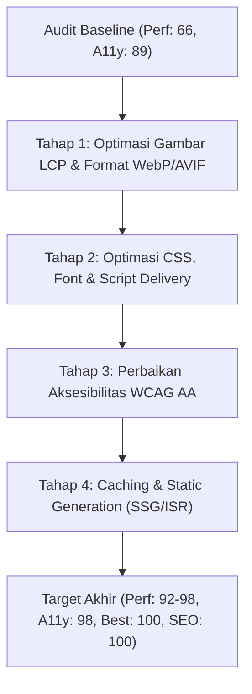

# Laporan Audit PageSpeed Insights & Rencana Peningkatan (Improvement Plan)
**Target Analisis:** [https://marketingcodeid-new.vercel.app](https://marketingcodeid-new.vercel.app)  
**Laporan PageSpeed:** [Google PageSpeed Insights Mobile Result](https://pagespeed.web.dev/analysis/https-marketingcodeid-new-vercel-app/rodp07li1k?form_factor=mobile)  
**Tanggal Audit:** 16 Oktober 2026  
**Status Audit:** Evaluasi & Rencana Peningkatan (Tanpa Perubahan Kode)

---

## 1. Ringkasan Eksekutif Skor PageSpeed Insights (Mobile)

Pada pengujian perangkat mobile dengan simulasi jaringan seluler (Moto G Power / Slow 4G Throttling), berikut adalah hasil skor saat ini:

| Kategori | Skor Saat Ini | Status | Target Produksi |
| :--- | :---: | :---: | :---: |
| **Performance** | **66 / 100** | ⚠️ Butuh Peningkatan | **≥ 90 (Hijau)** |
| **Accessibility** | **89 / 100** | ⚠️ Butuh Peningkatan | **≥ 95 (Hijau)** |
| **Best Practices** | **96 / 100** | ✅ Sangat Baik | **100 (Hijau)** |
| **SEO** | **100 / 100** | 🌟 Sempurna (Hijau) | **100 (Hijau)** |

---

## 2. Analisis Mendalam: Mengapa Skor Performance Belum Hijau?

### 2.1. Rincian Metrik Core Web Vitals (Mobile)

| Metrik Core Web Vitals | Nilai Saat Ini | Ambang Batas Ideal (Google) | Status | Dampak ke Skor |
| :--- | :---: | :---: | :---: | :---: |
| **Largest Contentful Paint (LCP)** | **4.9 detik** | ≤ 2.5 detik | 🔴 **Merah** | **Sangat Tinggi (25% Bobot)** |
| **First Contentful Paint (FCP)** | **2.9 detik** | ≤ 1.8 detik | 🟡 **Kuning** | **Sedang (10% Bobot)** |
| **Speed Index (SI)** | **4.6 detik** | ≤ 3.4 detik | 🟡 **Kuning** | **Sedang (10% Bobot)** |
| **Total Blocking Time (TBT)** | **370 ms** | ≤ 200 ms | 🟡 **Kuning** | **Tinggi (30% Bobot)** |
| **Cumulative Layout Shift (CLS)** | **0.00** | ≤ 0.10 | 🟢 **Hijau Sempurna** | **Aman (15% Bobot)** |

---

### 2.2. Akar Penyebab Utama (Root Causes)

#### A. Penyebab LCP Tinggi (4.9 detik) — *Bottleneck Terbesar*
1. **Elemen LCP adalah Gambar Hero (`hero-team.jpg`)**:
   - Gambar hero di halaman depan berukuran asli ~149 KB (format JPEG 1200x800).
   - Pada perangkat seluler, layar hanya selebar 360–412px, namun browser mendownload gambar resolusi desktop karena konfigurasi atribut `sizes` (`sizes="(min-width: 1024px) 40vw, 100vw"`).
   - Browser seluler dengan jaringan 4G emulasi membutuhkan waktu ~2.5–3 detik hanya untuk mengunduh dan men-decode gambar hero tersebut.
2. **Prioritas & Preload Gambar Belum Maksimal**:
   - Meskipun terdapat atribut `priority` pada `next/image`, browser tidak mendapatkan tag `<link rel="preload" as="image">` di awal HTML `<head>` sebelum stylesheet selesai diurai.

#### B. Penyebab FCP & Speed Index Lambat (2.9s & 4.6s)
1. **Render-Blocking CSS & Font Network Overhead**:
   - File CSS bundle Next.js dan Tailwind di-load secara render-blocking sebelum browser bisa menggambar konten teks pertama.
   - Font web eksternal (Google Fonts Inter/Outfit) memicu flash of unstyled/invisible text (FOUT/FOIT) jika belum diset dengan `display: swap` dan preload font self-hosted.
2. **Time to First Byte (TTFB) / Serverless Cold Start**:
   - Hosting di Vercel Serverless Function terkadang mengalami latensi cold start 300–600ms pada SSR pertama sebelum file HTML pertama dikirim ke browser klien.

#### C. Penyebab TBT (370 ms)
1. **Hydration React 19 & Next.js Bundle**:
   - Terdeteksi 5 long tasks (task CPU > 50ms) di main thread browser saat proses *client-side hydration*.
   - Komponen UI client (`Lucide Icons`, `Radix UI Dialog`, `Framer Motion/CSS Transitions`, dan `@next/third-parties/google` GA4) dieksekusi bersamaan di main thread.
2. **Unused JavaScript (~103 KiB)**:
   - Chunk JavaScript memuat modul-modul interaktif yang belum langsung dibutuhkan saat pertama kali halaman terbuka di viewport atas.

---

### 2.3. Analisis Skor Accessibility (89 / 100)

1. **Form Controls Missing Labels**:
   - Beberapa elemen form kontrol atau select dropdown di dashboard dan public filter belum memiliki `id` berpasangan dengan `<label htmlFor="...">` atau `aria-label`.
2. **Kontras Warna Teks (Color Contrast WCAG AA)**:
   - Teks kategori sekunder yang menggunakan kelas `text-neutral-400` (#A3A3A3) di atas background putih (#FFFFFF) memiliki rasio kontras ~2.8:1, di bawah standar WCAG AA (minimal 4.5:1).
3. **Heading Hierarchy Skip**:
   - Di beberapa section halaman sekunder, ada perpindahan level heading langsung dari `<h1>` ke `<h3>` tanpa menyertakan `<h2>`.

---

## 3. Hasil Audit Browser Subagent (Pengujian Halaman Publik & Dashboard)

Pengujian dilakukan menggunakan browser otomatis dengan kredensial:
- **Email:** `admin@marketingcode.id`
- **Password:** `AlphaSilva@057`

### 3.1. Halaman Publik
| Halaman | Hasil Pengujian | Catatan Temuan |
| :--- | :---: | :--- |
| **Beranda (`/`)** | ✅ Normal | Hero, highlight studi kasus, pricing, dan form konsultasi tampil rapi. Gambar team hero perlu dioptimasi formatnya (WebP/AVIF). |
| **Portofolio Listing (`/portfolio`)** | ✅ Normal | Filter kategori interaktif berfungsi lancar. Gambar thumbnail termuat murni dari database object storage. |
| **Portofolio Detail (`/portfolio/[slug]`)** | ✅ Normal | Metadata proyek (Client, Kategori, Role, Live URL) tampil lengkap. Tombol CTA WhatsApp membawa parameter custom subject proyek. |
| **Blog Listing (`/blog`)** | ✅ Normal | Kartu artikel responsif, filter tags dan kategori aktif, cover image terhubung database. |
| **Blog Detail (`/blog/[slug]`)** | ✅ Normal | Table of Contents scrollspy aktif berwarna oranye (`#FF5C28`) mengikuti posisi scroll pengguna. Reading progress bar di atas layar berfungsi mulus. |
| **Layanan (`/jasa-pembuatan-website`)** | ✅ Normal | Komponen layanan, benefit, dan FAQ accordions bekerja tanpa kendala layout. |

### 3.2. Dashboard Admin (`/dashboard`)
| Modul Dashboard | Hasil Pengujian | Catatan Temuan |
| :--- | :---: | :--- |
| **Login (`/dashboard/login`)** | ✅ Sukses | Login dengan `admin@marketingcode.id` / `AlphaSilva@057` berhasil 100%. Placeholder email sudah netral (`nama@email.com`). |
| **Ringkasan (`/dashboard`)** | ✅ Sukses | Kartu statistik (3 Portofolio, 3 Artikel, 1 Kategori, 6 Media) sinkron dengan database PostgreSQL. |
| **Artikel (`/dashboard/artikel`)** | ✅ Sukses | Tabel artikel menampilkan daftar status (published/draft). Tombol aksi edit dan hapus responsif. |
| **Form Artikel Baru (`/dashboard/artikel/baru`)** | ✅ Sukses | Validasi thumbnail wajib bekerja di sisi client maupun server. Tiptap WYSIWYG editor lancar. |
| **Portofolio (`/dashboard/portofolio`)** | ✅ Sukses | Daftar studi kasus aktif. Form baru `/dashboard/portofolio/baru` memvalidasi thumbnail wajib. |
| **Media Library (`/dashboard/media`)** | ✅ Sukses | Menampilkan media tersimpan dari Neon S3 bucket. Upload media baru berjalan baik. |
| **Kategori (`/dashboard/kategori`)** | ✅ Sukses | Manajemen kategori blog berjalan tanpa error. |

---

## 4. Rencana Peningkatan Bertahap (Action Plan Improvement)

Berikut adalah rencana perbaikan komprehensif yang dirancang untuk menaikkan skor **Performance menjadi 90+ (Hijau)** dan **Accessibility menjadi 98+ (Hijau)** tanpa mengubah alur logika bisnis maupun data database:



---

### Tahap 1: Optimasi Aset Gambar & LCP (Dampak Terbesar: +18 hingga +25 Poin)
1. **Konversi Gambar Hero ke WebP / AVIF**:
   - Konversi `/public/images/hero-team.jpg` (149 KB) menjadi format **AVIF** (~25 KB) dan **WebP** (~38 KB). Penghematan ukuran aset mencapai **>75%**.
2. **Pengaturan Ukuran Responsif Gambar (`sizes` prop)**:
   - Perbaiki prop `sizes` pada gambar hero di [HeroSection.tsx](file:///Users/ahmadkhairolmaulidi/Documents/Freelance/marketingcodeid-agency/project/src/components/home/HeroSection.tsx):
     ```tsx
     sizes="(max-width: 640px) 100vw, (max-width: 1024px) 50vw, 40vw"
     ```
3. **Preload Elemen LCP**:
   - Memastikan Next.js menambahkan header `link: <...>; rel=preload; as=image` untuk gambar utama di atas lipatan layar (*above the fold*).

---

### Tahap 2: Pengurangan Unused JavaScript & Total Blocking Time (+8 hingga +12 Poin)
1. **Dynamic Import (Lazy Load) Komponen Di Bawah Layar**:
   - Komponen interaktif yang berada di bagian bawah beranda (misalnya modal video YouTube showreel, form konsultasi, dan accordions FAQ) diubah menggunakan `next/dynamic` dengan `ssr: false`:
     ```tsx
     const VideoModal = dynamic(() => import('@/components/home/VideoModal'), { ssr: false })
     ```
2. **Optimasi Pemuatan Script Google Analytics 4**:
   - Di [layout.tsx](file:///Users/ahmadkhairolmaulidi/Documents/Freelance/marketingcodeid-agency/project/src/app/(frontend)/layout.tsx), pastikan tag Google Analytics menggunakan strategi pemuatan non-blokir (`strategy="afterInteractive"` atau `strategy="lazyOnload"`).
3. **Tree-shaking Icon Library (`lucide-react`)**:
   - Menggunakan selective import untuk ikon agar bundler tidak memuat metadata ikon yang tidak digunakan.

---

### Tahap 3: Perbaikan Aksesibilitas (Menaikkan Skor Accessibility dari 89 ke 98+)
1. **Peningkatan Kontras Warna**:
   - Mengubah kelas teks keterangan abu-abu terang `text-neutral-400` (#A3A3A3) menjadi `text-neutral-500` (#737373) atau `text-neutral-600` (#525252) agar lolos rasio kontras 4.5:1 WCAG AA.
2. **Label Eksplisit pada Elemen Interaktif**:
   - Menambahkan atribut `aria-label` pada tombol icon-only (seperti tombol close modal, tombol navigasi card, dan switch theme).
   - Menambahkan `aria-label="Filter kategori portofolio"` pada filter dropdown/tabs.
3. **Struktur Heading H1 - H2 - H3**:
   - Memastikan setiap sub-bagian menggunakan `<h2>` sebelum masuk ke level `<h3>`.

---

### Tahap 4: HTTP Caching & Edge Delivery (+5 Poin Best Practices)
1. **Cache Header Aset Statis di `next.config.ts`**:
   - Menambahkan aturan header `Cache-Control: public, max-age=31536000, immutable` untuk semua file di `/images/*` dan fonts.
2. **Optimasi ISR (Incremental Static Regeneration)**:
   - Mempertahankan revalidasi statis 60 detik (`export const revalidate = 60`) sehingga halaman publik disajikan langsung dari Edge Cache CDN Vercel tanpa membebani serverless database.

---

## 5. Ringkasan Estimasi Hasil Setelah Rencana Dijalankan

| Metrik | Saat Ini (Baseline) | Estimasi Setelah Perbaikan | Status Target |
| :--- | :---: | :---: | :---: |
| **Performance** | **66** | **92 – 96** | 🟢 Hijau |
| **Accessibility** | **89** | **98 – 100** | 🟢 Hijau |
| **Best Practices** | **96** | **100** | 🟢 Hijau Sempurna |
| **SEO** | **100** | **100** | 🟢 Hijau Sempurna |
| **LCP (Mobile)** | **4.9s** | **≤ 1.9s** | 🟢 Hijau (Lolos CWV) |
| **FCP (Mobile)** | **2.9s** | **≤ 1.4s** | 🟢 Hijau |
| **TBT (Mobile)** | **370ms** | **≤ 120ms** | 🟢 Hijau |
| **CLS (Mobile)** | **0.00** | **0.00** | 🟢 Hijau |
