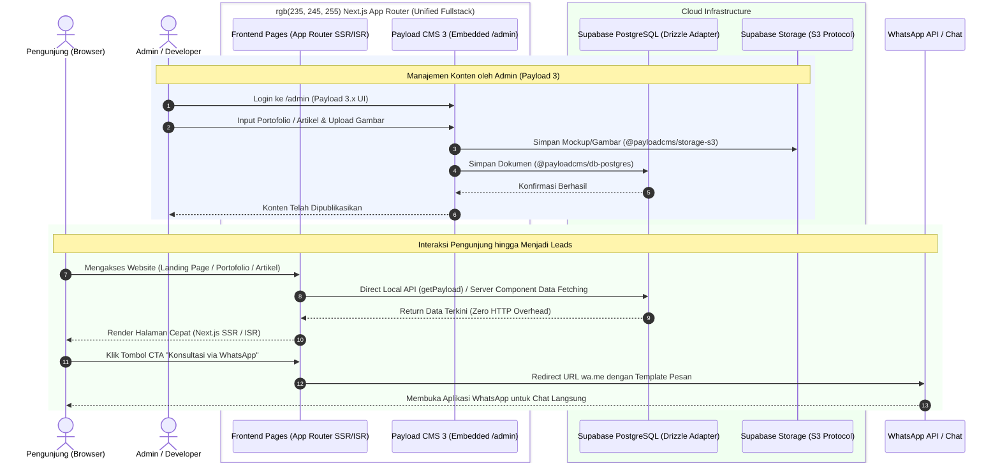
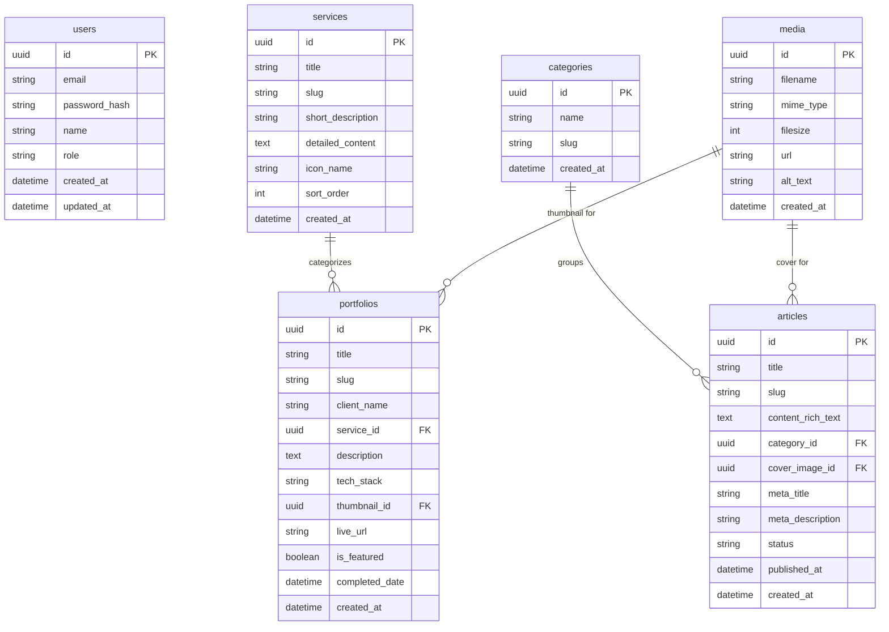

# PRD — Project Requirements Document
**Website Company Profile & Portfolio Agency (MarketingCode ID)**

---

## 1. Overview
Aplikasi ini bertujuan untuk membangun identitas digital profesional dan saluran akuisisi klien utama bagi **MarketingCode ID Agency**, sebuah agensi penyedia jasa pembuatan website custom, aplikasi mobile, dan digital marketing (Facebook Ads & Google Ads).

Masalah utama yang diselesaikan meliputi:
1. Pemilik bisnis konvensional yang belum memiliki website dan identitas digital.
2. Pelaku usaha yang kesulitan memahami dan menjalankan kampanye digital marketing yang efektif.
3. Instansi pemerintahan atau korporasi yang membutuhkan pengembangan aplikasi custom namun terkendala ketiadaan tim teknis/SDM internal.

Tujuan utama website adalah menyajikan portofolio kredibel dan artikel edukatif (SEO organik) untuk mengonversi pengunjung potensial menjadi klien melalui saluran konsultasi langsung via WhatsApp.

---

## 2. Requirements
Berikut adalah persyaratan tingkat tinggi untuk pengembangan sistem:
- **Aksesibilitas & Responsivitas:** Website harus sepenuhnya responsif di semua perangkat (Desktop, Tablet, dan Smartphone) dengan waktu muat (*load time*) cepat untuk mendukung retensi pengunjung dan performa SEO.
- **Model Pengguna:**
  - **Admin/Developer Tunggal:** Memiliki akses ke CMS panel untuk mengelola portofolio proyek, mempublikasikan artikel SEO, dan mengunggah aset media.
  - **Pengunjung Publik:** Akses penuh untuk membaca dan menelusuri konten tanpa perlu mendaftar atau login.
- **Konversi & Call-to-Action (CTA):** Tidak ada transaksi checkout langsung di website. Seluruh konversi difokuskan pada tombol CTA yang mengarah langsung ke tautan obrolan WhatsApp bisnis agensi dengan pre-filled text dinamis.
- **SEO-First Architecture:** Struktur halaman, slug URL, metadata, schema markup (JSON-LD), serta open graph tag harus dioptimalkan untuk pengindeksan mesin pencari (Google).

---

## 3. Core Features
Fitur-fitur kunci yang wajib ada dalam versi pertama (MVP):

1. **Halaman Publik (Visitor Facing)**
   - **Hero Section & Value Proposition:** Pesan pembuka yang jelas mengenai solusi agensi beserta tombol CTA cepat ke WhatsApp.
   - **Katalog Layanan (Services Showcase):** Informasi mendalam mengenai 3 pilar layanan utama: *Custom Web Development*, *Mobile Apps*, dan *Digital Marketing Ads*.
   - **Galeri Portofolio (Case Studies):** Daftar studi kasus proyek yang telah diselesaikan lengkap dengan gambar, deskripsi, teknologi yang digunakan, dan tautan live demo (jika ada).
   - **Blog & Artikel SEO:** Wadah publikasi artikel edukasi bisnis dan teknologi untuk mendatangkan traffic organik secara kontinu.
   - **Floating WhatsApp Button:** Tombol melayang (*sticky button*) yang selalu terlihat di sudut layar mobile dan desktop untuk mempermudah pengunjung memulai konsultasi.

2. **CMS Admin Panel (Payload CMS)**
   - **Autentikasi Admin:** Login terproteksi untuk Admin/Developer.
   - **Manajemen Portofolio:** Fitur tambah, sunting, arsip, dan hapus proyek (judul, deskripsi, client, cover image, galeri mockup, stack tech).
   - **Manajemen Artikel (Rich Text Editor):** Editor penulisan artikel dengan dukungan *rich text*, tag/kategori, custom slug URL, serta custom SEO meta tags (title, description, image).
   - **Media Management:** Pengelolaan upload gambar/mockup yang teroptimasi dan tersimpan di cloud storage.

---

## 4. User Flow
Alur interaksi pengunjung dan alur pengelolaan konten oleh Admin:

### Alur Pengunjung (Visitor to Lead Flow)
1. **Discovery:** Pengunjung menemukan website melalui pencarian Google (SEO organik) atau tautan konten media sosial.
2. **Exploration:** Pengunjung membaca artikel solusi atau menelusuri halaman layanan dan studi kasus portofolio.
3. **Engagement:** Pengunjung teryakinkan oleh portofolio dan kredibilitas agensi, kemudian menekan tombol **"Konsultasi Sekarang"** (CTA WhatsApp).
4. **Conversation & Deal:** Sistem mengalihkan pengunjung ke aplikasi WhatsApp dengan template pesan otomatis. Diskusi mendalam, penawaran harga, dan kesepakatan pembayaran dilakukan langsung secara personal.

### Alur Admin (Content Management Flow)
1. **Login:** Admin masuk ke dashboard Payload CMS (`/admin`).
2. **Publish Project:** Admin mengisi data proyek baru yang telah selesai dikerjakan beserta mockup gambar.
3. **Write SEO Article:** Admin menulis artikel edukasi bisnis/teknologi dengan memasukkan target kata kunci dan metadata SEO.
4. **Publish & Index:** Konten terbit secara instan di website Next.js dan siap diindeks oleh mesin pencari.

---

## 5. Architecture
Gambaran arsitektur sistem berbasis **Payload CMS 3.x Native Next.js** (berjalan dalam satu runtime Next.js terpadu tanpa backend terpisah), terhubung ke Supabase PostgreSQL:

---

## 6. Database Schema

Berikut adalah Entity Relationship Diagram (ERD) yang menggambarkan struktur database utama yang dikelola melalui Payload CMS 3 dan Supabase PostgreSQL:

| Tabel | Deskripsi |
|---|---|
| **users** | Akun Admin/Developer untuk autentikasi dan manajemen Payload CMS. |
| **services** | Master data layanan agensi (Web Custom, Aplikasi Mobile, Ads). |
| **portfolios** | Data studi kasus dan proyek yang telah selesai dikerjakan sebagai portofolio agensi. |
| **articles** | Artikel blog dan edukasi yang dioptimasi untuk kebutuhan SEO organik. |
| **categories** | Kategori pengelompokan untuk artikel blog (misal: *Tips SEO*, *Web Tech*, *Studi Kasus*). |
| **media** | Aset gambar, ikon, dan mockup portofolio yang diunggah melalui Payload CMS. |

---

## 7. Design & Technical Constraints (Verified via Context7)

Berdasarkan hasil investigasi dokumentasi resmi melalui **Context7**, berikut adalah spesifikasi teknologi versi terbaru yang wajib digunakan untuk menjamin stabilitas, kompatibilitas, dan performa tinggi:

### 1. Versioning & Package Stack

| Komponen | Paket / Dependency | Rekomendasi Versi Terbaru | Catatan & Kompatibilitas Context7 |
|---|---|---|---|
| **Fullstack Framework** | `next`, `react`, `react-dom` | **Next.js 15+ / 16** (React 19) | App Router dengan Server Components, dynamic `generateMetadata`, dan Turbopack. |
| **Headless CMS Engine** | `payload`, `@payloadcms/next`, `@payloadcms/ui` | **Payload 3.x (`^3.85.0`)** | Arsitektur native Next.js: Admin panel tertanam langsung di `/app/(payload)/admin` tanpa server Node terpisah. |
| **Rich Text Editor** | `@payloadcms/richtext-lexical` | **`^3.85.0`** | Editor modern Lexical bawaan Payload 3 untuk penulisan artikel SEO. |
| **Database Adapter** | `@payloadcms/db-postgres` | **`^3.85.0`** | Drizzle ORM-backed Postgres adapter dengan pool connection support. |
| **Cloud Database** | **Supabase PostgreSQL** | **PostgreSQL 15 / 16** | Koneksi via Supabase Connection Pooler (port `6543` / `5432`) melalui `DATABASE_URL`. |
| **Media / Asset Storage** | `@payloadcms/storage-s3` | **`^3.85.0`** | Terhubung ke Supabase Storage via S3-compatible API protocol. |
| **Runtime Environment** | Node.js | **Node.js 20+ LTS / 22+** | Kompatibel dengan TypeScript 5.5+ dan pnpm/npm. |

### 2. Arsitektur Terpadu (Zero-Overhead Local API)
- Menggunakan kemampuan Payload 3.x `getPayload({ config })` langsung di dalam Next.js Server Components.
- Frontend dapat mengambil data portofolio dan artikel langsung dari database via query lokal tanpa latensi REST/GraphQL HTTP request antar-server.

### 3. Integrasi Call-to-Action (WhatsApp)
- Format schema URL: `https://wa.me/<NOMOR_WA>?text=<ENCODED_MESSAGE>`.
- Parameter pesan dinamis:
  - Dari Halaman Layanan Web: *"Halo MarketingCode ID, saya ingin konsultasi kebutuhan pembuatan website custom untuk bisnis saya..."*
  - Dari Halaman Portofolio: *"Halo MarketingCode ID, saya melihat portofolio proyek [Nama Proyek] dan tertarik membuat sistem serupa..."*
  - Dari Artikel Blog: *"Halo MarketingCode ID, saya membaca artikel [Judul Artikel] dan ingin diskusi lebih lanjut..."*

### 4. Design & Frontend Flexibility
- UI frontend bersifat modular untuk mempermudah pemasangan tema skimm/kustom di tahap berikutnya.
- Menjamin *Core Web Vitals* bernilai tinggi (LCP < 2.5s, CLS < 0.1) untuk mendukung peringkat SEO di Google Search.
