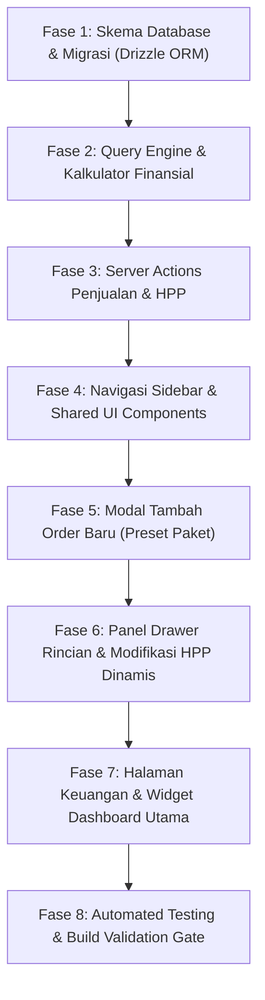

# Breakdown Task Implementasi: Dashboard Penjualan, Rincian HPP Dinamis, & Analisis Profit

Dokumen ini memecah [plan-dashboard-keuangan-hpp-profit.md](file:///Users/ahmadkhairolmaulidi/Documents/Freelance/marketingcodeid-agency/project/docs/plan-dashboard-keuangan-hpp-profit.md) menjadi unit tugas (*tasks*) kecil, terstruktur, dan berurutan agar dapat dieksekusi secara bertahap oleh AI agent tanpa menimbulkan regresi atau masalah pada fitur dashboard yang sudah ada.

---

## Ringkasan Alur Eksekusi Antar Fase

---

## Fase 1: Skema Database & Migrasi (Drizzle ORM & PostgreSQL)

Tujuan: Menambahkan tabel database relasional untuk menyimpan transaksi order penjualan agensi dan rincian item pos biaya HPP yang dapat disesuaikan.

- [x] **Task 1.1: Definisi Tabel `orders` dan `order_hpp_items` di Skema Drizzle**
  - **Target File:** [src/db/schema.ts](file:///Users/ahmadkhairolmaulidi/Documents/Freelance/marketingcodeid-agency/project/src/db/schema.ts)
  - **Spesifikasi:**
    - Tambahkan tabel `orders` dengan kolom:
      - `id`: uuid primary key default random
      - `orderNumber`: varchar(30) not null unique (format: `MC-YYYYMM-XXX`)
      - `clientName`: varchar(255) not null
      - `clientPhone`: varchar(30) not null
      - `clientCompany`: varchar(255) nullable
      - `serviceCategory`: varchar(50) not null (`'website'`, `'ads'`, `'mobile'`, `'custom'`)
      - `packageName`: varchar(255) not null
      - `sellingPrice`: integer not null (Harga jual ke klien dalam IDR)
      - `totalHpp`: integer not null (Total akumulasi HPP proyek dalam IDR)
      - `netProfit`: integer not null (`sellingPrice - totalHpp`)
      - `profitMargin`: numeric(5, 2) not null (`(netProfit / sellingPrice) * 100`)
      - `paymentStatus`: varchar(20) not null default `'paid'` (`'paid'`, `'down_payment'`, `'unpaid'`)
      - `paidAmount`: integer not null default 0
      - `projectStatus`: varchar(30) not null default `'in_progress'` (`'in_progress'`, `'completed'`, `'revision'`, `'cancelled'`)
      - `orderDate`: timestamp with time zone not null default now
      - `notes`: text nullable
      - `createdBy`: uuid references `users.id` on delete set null
      - `createdAt`: timestamp with time zone not null default now
      - `updatedAt`: timestamp with time zone not null default now
      - Index: `orders_order_date_idx` pada `orderDate`, `orders_payment_status_idx` pada `paymentStatus`.
    - Tambahkan tabel `orderHppItems` dengan kolom:
      - `id`: uuid primary key default random
      - `orderId`: uuid not null references `orders.id` on delete cascade
      - `category`: varchar(50) not null (`'hosting'`, `'domain'`, `'freelancer'`, `'license'`, `'tools'`, `'other'`)
      - `description`: varchar(255) not null (contoh: `'Hosting Cloud VPS 1 Tahun (Promo Hostinger)'`)
      - `amount`: integer not null (Nominal pengeluaran modal dalam IDR)
      - `notes`: text nullable
      - `createdAt`: timestamp with time zone not null default now
      - `updatedAt`: timestamp with time zone not null default now
      - Index: `order_hpp_items_order_id_idx` pada `orderId`.
  - **Acceptance Criteria:** Skema TypeScript valid, tipe relasi cascade delete terpasang benar, tidak ada error kompilasi.

- [x] **Task 1.2: Ekspor Tipe Data TypeScript Finansial Terpusat**
  - **Target File:** `src/types/financial.ts`
  - **Spesifikasi:**
    - Ekspor tipe inferensi Drizzle: `OrderRow`, `NewOrder`, `OrderHppItemRow`, `NewOrderHppItem`.
    - Ekspor tipe gabungan: `OrderWithHppBreakdown = OrderRow & { hppItems: OrderHppItemRow[] }`.
    - Ekspor status types:
      - `PaymentStatus = 'paid' | 'down_payment' | 'unpaid'`
      - `ProjectStatus = 'in_progress' | 'completed' | 'revision' | 'cancelled'`
      - `HppCategory = 'hosting' | 'domain' | 'freelancer' | 'license' | 'tools' | 'other'`
      - `ServiceCategory = 'website' | 'ads' | 'mobile' | 'custom'`
    - Ekspor interface ringkasan statistik finansial: `FinancialSummaryStats`.
  - **Acceptance Criteria:** Tipe data dapat diimpor secara modular tanpa circular dependency.

- [x] **Task 1.3: Eksekusi Migrasi Database Drizzle Kit**
  - **Target Perintah:** `pnpm drizzle-kit push` (atau generate SQL migration).
  - **Spesifikasi:**
    - Jalankan sinkronisasi skema tabel `orders` dan `order_hpp_items` ke database PostgreSQL.
  - **Acceptance Criteria:** Perintah exit code 0, tabel terbuat di database, relasi foreign key terverifikasi.

---

## Fase 2: Query Engine & Kalkulator Finansial

Tujuan: Membangun logika matematika finansial, fungsi pembantu kalkulasi HPP dan laba bersih, serta query agregasi database.

- [x] **Task 2.1: Modul Utilitas Kalkulasi Laba Bersih & Margin**
  - **Target File:** `src/lib/financial/calculator.ts`
  - **Spesifikasi:**
    - Buat fungsi `calculateProfitAndMargin(sellingPrice: number, totalHpp: number): { netProfit: number, profitMargin: number }`:
      - `netProfit = sellingPrice - totalHpp`
      - `profitMargin = sellingPrice > 0 ? Number(((netProfit / sellingPrice) * 100).toFixed(2)) : 0`
    - Buat fungsi `generateOrderNumber(date?: Date, sequence?: number): string` menghasilkan format unik `ORD-YYYYMM-XXX`.
    - Buat fungsi pemformat mata uang rupiah: `formatRupiah(amount: number): string` (contoh: `Rp 1.190.000`).
  - **Acceptance Criteria:** Unit test kalkulasi angka negatif (rugi), angka 0, dan angka normal terverifikasi 100% akurat.

- [x] **Task 2.2: Preset Data Paket Layanan & Estimasi HPP Awal**
  - **Target File:** `src/lib/financial/package-presets.ts`
  - **Spesifikasi:**
    - Definisikan konstanta daftar paket resmi agensi MarketingCode.ID:
      - *Website:*
        - `Landing Page & Iklan`: Harga Jual `1190000`, HPP bawaan: Hosting `200000`, Domain `150000`.
        - `Web Katalog, Profil & Blog`: Harga Jual `2190000`, HPP bawaan: Hosting `350000`, Domain `150000`, Lisensi `150000`.
        - `Company Profile Pro / Toko Online`: Harga Jual `3490000`, HPP bawaan: Hosting `500000`, Domain `200000`, Tools `300000`.
      - *Iklan Digital:*
        - `Starter Trial 14 Hari`: Harga Jual `790000`, HPP bawaan: Saldo Iklan `500000`, Setup `100000`.
        - `Growth 30 Hari`: Harga Jual `1490000`, HPP bawaan: Saldo Iklan `1000000`.
        - `Omnichannel`: Harga Jual `2890000`, HPP bawaan: Saldo Iklan `2000000`.
      - *Mobile Application:*
        - `MVP Mobile Starter`: Harga Jual `18000000`, HPP bawaan: Server `1500000`, Aset `1000000`.
        - `Full Commercial App`: Harga Jual `35000000`, HPP bawaan: Server `3000000`, Gateway `1000000`.
      - *Kustom:* Bebas masukkan nominal dan item HPP.
  - **Acceptance Criteria:** Menyediakan fungsi `getPackagePreset(category, name)` untuk pengisian otomatis form.

- [x] **Task 2.3: Modul Query Database Agregasi Finansial**
  - **Target File:** `src/lib/financial/queries.ts`
  - **Spesifikasi:**
    - Buat fungsi `getFinancialSummary(period: 'current_month' | 'current_year' | 'all')`:
      - Query agregat SQL `sum(sellingPrice)`, `sum(totalHpp)`, `sum(netProfit)`, dan hitung rata-rata margin.
    - Buat fungsi `getOrdersList(filters?: { period?: string, paymentStatus?: string, search?: string })`:
      - Query daftar order dengan pengurutan `orderDate desc`.
    - Buat fungsi `getOrderWithHppDetails(orderId: string)`:
      - Query satu order beserta seluruh baris `orderHppItems`-nya.
    - Buat fungsi `recalculateOrderTotals(orderId: string, tx?: any)`:
      - Menghitung ulang `sum(amount)` dari tabel `orderHppItems`, me-rekalkulasi `netProfit` dan `profitMargin`, lalu mengupdate baris `orders` terkait.
  - **Acceptance Criteria:** Query SQL efisien, agregasi periode bulanan dan tahunan akurat sesuai zona waktu lokal.

---

## Fase 3: Server Actions Penjualan & HPP

Tujuan: Membangun mutasi backend yang aman untuk mencatat order baru, mengupdate status, dan memodifikasi komponen biaya HPP secara dinamis.

- [x] **Task 3.1: Server Action Pembuatan Order Baru (`createOrderAction`)**
  - **Target File:** `src/app/(dashboard)/dashboard/(main)/keuangan/actions.ts`
  - **Spesifikasi:**
    - Memvalidasi otentikasi admin via `requireAdmin()`.
    - Validasi payload via Zod: `clientName`, `clientPhone`, `serviceCategory`, `packageName`, `sellingPrice`, `orderDate`, dan daftar item HPP awal (`category`, `description`, `amount`).
    - Jalankan database transaction:
      1. Simpan baris `orders`.
      2. Simpan baris-baris `orderHppItems`.
      3. Jalankan `recalculateOrderTotals` untuk memastikan angka sinkron 100%.
    - Revalidasi path: `revalidatePath('/dashboard/keuangan')` dan `revalidatePath('/dashboard')`.
  - **Acceptance Criteria:** Order baru tersimpan beserta rincian HPP awalnya, kalkulasi profit otomatis tersimpan benar.

- [x] **Task 3.2: Server Actions Modifikasi Rincian HPP Dinamis**
  - **Target File:** `src/app/(dashboard)/dashboard/(main)/keuangan/actions.ts`
  - **Spesifikasi:**
    - `updateHppItemAction(itemId, data)`: Mengubah nominal pos biaya (misal saat dapat promo hosting murah dari Rp 200rb jadi Rp 100rb) atau mengubah keterangannya, lalu otomatis memicu `recalculateOrderTotals`.
    - `addHppItemAction(orderId, data)`: Menambahkan pos biaya baru ke order yang sudah ada, lalu otomatis memicu `recalculateOrderTotals`.
    - `deleteHppItemAction(itemId)`: Menghapus pos biaya tertentu, lalu otomatis memicu `recalculateOrderTotals`.
    - Revalidasi path terkait setelah mutasi.
  - **Acceptance Criteria:** Modifikasi item HPP langsung me-rekalkulasi total HPP, laba bersih, dan margin pada order utama secara real-time.

- [x] **Task 3.3: Server Actions Update Status & Hapus Order**
  - **Target File:** `src/app/(dashboard)/dashboard/(main)/keuangan/actions.ts`
  - **Spesifikasi:**
    - `updateOrderStatusAction(orderId, { paymentStatus, paidAmount, projectStatus })`: Update status pembayaran (misal dari DP menjadi Lunas) atau status pengerjaan.
    - `deleteOrderAction(orderId)`: Menghapus order beserta seluruh rincian HPP-nya (*cascade delete*).
  - **Acceptance Criteria:** Mutasi terproteksi admin, feedback error tertangani dengan pesan yang ramah pengguna.

---

## Fase 4: Navigasi Sidebar & Shared UI Components

Tujuan: Menghubungkan modul baru ke sistem navigasi dashboard dan menyediakan komponen visual pendukung.

- [x] **Task 4.1: Pembaruan Navigasi Sidebar Dashboard**
  - **Target File:** [src/components/dashboard/sidebar-nav.tsx](file:///Users/ahmadkhairolmaulidi/Documents/Freelance/marketingcodeid-agency/project/src/components/dashboard/sidebar-nav.tsx) dan `src/components/dashboard/MobileSidebar.tsx`
  - **Spesifikasi:**
    - Tambahkan kategori menu baru: `MANAJEMEN BISNIS`.
    - Tambahkan item menu: `Keuangan & Order` menuju rute `/dashboard/keuangan` dengan icon Lucide `Wallet`.
    - Pastikan styling, transisi hover, dan active state konsisten dengan menu lainnya.
    - Kepatuhan mutlak tanpa emoji.
  - **Acceptance Criteria:** Menu muncul sempurna di sidebar desktop dan mobile drawer tanpa merusak layout.

- [x] **Task 4.2: Komponen Kartu Ringkasan Finansial (`FinancialStatCard.tsx`)**
  - **Target File:** `src/components/dashboard/financial/FinancialStatCard.tsx`
  - **Spesifikasi:**
    - Kartu metrik responsif:
      - Label metrik (contoh: *Laba Bersih Bulan Ini*)
      - Nilai utama dalam Rupiah dengan typography tebal dan jelas
      - Sub-teks pembanding (contoh: *Tahun ini: Rp 88.600.000*)
      - Icon pendukung dari Lucide React (misal `TrendingUp`, `Coins`, `Percent`, `Receipt`)
      - Warna aksen indikator (hijau untuk laba, abu-abu/biru untuk omset/HPP).
  - **Acceptance Criteria:** Desain elegan, responsif, selaras dengan tema gelap/terang dashboard.

- [x] **Task 4.3: Komponen Badge Status Finansial & Proyek**
  - **Target File:** `src/components/dashboard/financial/FinancialBadges.tsx`
  - **Spesifikasi:**
    - `PaymentStatusBadge`:
      - `'paid'` -> Lunas (Warna emerald)
      - `'down_payment'` -> DP (Warna amber)
      - `'unpaid'` -> Belum Bayar (Warna rose)
    - `ProjectStatusBadge`:
      - `'in_progress'` -> Pengerjaan (Warna blue)
      - `'completed'` -> Selesai (Warna emerald)
      - `'revision'` -> Revisi (Warna orange)
      - `'cancelled'` -> Dibatalkan (Warna zinc)
  - **Acceptance Criteria:** Badge rapi, strict tanpa karakter emoji.

---

## Fase 5: Modal Tambah Order Baru (Preset Paket & Auto-Calculate)

Tujuan: Membangun formulir input order yang memudahkan admin memilih paket layanan dan secara otomatis mengisikan harga jual serta estimasi HPP awal.

- [x] **Task 5.1: Komponen Modal Form Input Order (`OrderFormModal.tsx`)**
  - **Target File:** `src/components/dashboard/financial/OrderFormModal.tsx`
  - **Spesifikasi:**
    - Modal dialog dengan form:
      1. Kategori Layanan (Website, Iklan, Mobile App, Kustom).
      2. Dropdown Paket Layanan: memilih paket otomatis menyetel Harga Jual dan mengisi rincian estimasi HPP awal.
      3. Harga Jual Riil: dapat diedit manual jika ada diskon atau biaya ekstra.
      4. Section Rincian HPP Awal: daftar item biaya bawaan (Hosting, Domain, Lisensi) dengan opsi edit nominal atau tambah item sebelum disimpan.
      5. Kotak Kalkulator Live: menampilkan *Estimasi Laba Bersih* dan *Margin %* saat admin mengetik angka.
      6. Form Data Klien: Nama Klien, Nama Perusahaan/Usaha, Nomor WhatsApp.
      7. Status Pembayaran: Lunas, DP (input nominal DP), Belum Bayar.
      8. Tanggal Order & Catatan.
    - Submit memanggil `createOrderAction` dengan feedback toast Sonner.
  - **Acceptance Criteria:** Validasi form via Zod pada client dan server, pengisian paket instan dan mulus.

---

## Fase 6: Panel Drawer Rincian & Modifikasi HPP Dinamis

Tujuan: Membangun fitur inti yang diminta pemilik agensi untuk melihat rincian modal proyek dan memodifikasinya kapan saja (misalnya saat ada promo hosting atau diskon domain).

- [x] **Task 6.1: Komponen Slide-Over Drawer Detail HPP (`HppDetailDrawer.tsx`)**
  - **Target File:** `src/components/dashboard/financial/HppDetailDrawer.tsx`
  - **Spesifikasi:**
    - Komponen Slide-over Drawer (muncul dari kanan layar saat tombol "Rincian HPP" di baris tabel diklik).
    - **Header Drawer:**
      - Nomor Order & Nama Klien
      - Paket yang Dibeli
      - Kartu Ringkasan Cepat: *Harga Jual: Rp X | Total HPP: Rp Y | Net Profit: Rp Z (Margin: XX%)*
    - **Daftar Tabel Rincian Pos Biaya HPP:**
      - Kolom: Kategori Pos (`Hosting`, `Domain`, `Freelancer`, `Lisensi`, `Tools`, `Lainnya`), Deskripsi Item, Nominal Biaya (IDR), Aksi.
      - **Edit Inline Cepat:** Nominal dan deskripsi pos biaya dapat langsung diedit (misal: hosting diubah dari `Rp 200.000` menjadi `Rp 100.000` karena dapat kupon promo).
      - **Tombol Hapus Item:** Menghapus pos biaya tertentu.
    - **Form Mini Tambah Pos Biaya Baru:**
      - Input: Pilih Kategori, Deskripsi (misal: *Beli Plugin Slider Tambahan*), Nominal (Rp ...).
      - Tombol *+ Tambah Pos Biaya*.
    - **Live Calculation:**
      - Perubahan nominal langsung mengupdate kalkulasi Total HPP, Net Profit, dan Margin di header panel secara instan di sisi client sebelum disimpan.
    - **Tombol Simpan:**
      - Menyimpan seluruh penyesuaian HPP ke server via Server Action.
  - **Acceptance Criteria:** Admin dapat mengubah harga pos biaya kapan saja dengan kalkulasi ulang laba bersih otomatis dan feedback visual yang jelas.

---

## Fase 7: Halaman Keuangan & Widget Dashboard Utama

Tujuan: Mengintegrasikan seluruh modul ke dalam halaman `/dashboard/keuangan` dan menambahkan widget ringkasan finansial di halaman depan dashboard utama.

- [x] **Task 7.1: Halaman Utama Laporan Keuangan (`/dashboard/keuangan/page.tsx`)**
  - **Target File:** `src/app/(dashboard)/dashboard/(main)/keuangan/page.tsx`
  - **Spesifikasi:**
    - Server Component dengan pre-fetching data statistik dan daftar order.
    - Render 4 Kartu KPI Finansial Utama:
      1. Laba Bersih Bulan Ini (dan total Tahun Ini)
      2. Total Omset Penjualan Bulan Ini (dan total Tahun Ini)
      3. Total Modal HPP Bulan Ini (dan total Tahun Ini)
      4. Rata-rata Profit Margin (%)
    - Tombol Header: `+ Tambah Order Baru` (membuka `OrderFormModal`) dan `Ekspor CSV`.
    - Filter Bar: Pilihan Bulan, Tahun, Status Pembayaran, dan Pencarian Klien.
    - Tabel Riwayat Order Transaktif dengan integrasi `HppDetailDrawer`.
  - **Acceptance Criteria:** Halaman termuat cepat (< 500ms), data teragregasi secara tepat, bebas error hidrasi.

- [x] **Task 7.2: Route Handler Ekspor CSV Laporan Finansial**
  - **Target File:** `src/app/api/financial/export-csv/route.ts`
  - **Spesifikasi:**
    - Endpoint download file CSV dengan header `Content-Type: text/csv` dan `Content-Disposition: attachment; filename="laporan-keuangan-marketingcode-{date}.csv"`.
    - Kolom CSV: No Order, Tanggal, Nama Klien, Nama Usaha, WhatsApp, Kategori, Paket, Harga Jual, Total HPP, Laba Bersih, Margin (%), Status Pembayaran, Status Proyek.
  - **Acceptance Criteria:** File CSV dapat diunduh dan dibuka langsung di Microsoft Excel atau Google Sheets tanpa masalah encoding karakter.

- [x] **Task 7.3: Integrasi Widget Ringkasan Finansial di Halaman Beranda Dashboard**
  - **Target File:** [src/app/(dashboard)/dashboard/(main)/page.tsx](file:///Users/ahmadkhairolmaulidi/Documents/Freelance/marketingcodeid-agency/project/src/app/(dashboard)/dashboard/(main)/page.tsx)
  - **Spesifikasi:**
    - Tambahkan section ringkasan finansial di atas daftar artikel/portofolio:
      - Menampilkan metrik cepat: *Profit Bulan Ini*, *Omset Bulan Ini*, *Profit Tahun Ini*, dan *Omset Tahun Ini*.
      - Tombol pintas: `+ Catat Order Baru` dan tautan `Lihat Detail Keuangan ->`.
  - **Acceptance Criteria:** Tampilan beranda dashboard semakin informatif bagi pemilik bisnis tanpa mengganggu fungsi CMS artikel dan portofolio.

---

## Fase 8: Automated Testing & Build Validation Gate

Tujuan: Memastikan seluruh fungsionalitas baru bebas dari celah keamanan, lulus protokol pengetesan proyek, dan memiliki performa optimal.

- [x] **Task 8.1: Pembuatan Automated Integration Tests**
  - **Target File:** `tests/int/financial-orders.int.spec.ts`
  - **Spesifikasi:**
    - Test suite mencakup:
      1. Uji fungsi kalkulasi: verifikasi `calculateProfitAndMargin` menghasilkan laba bersih dan margin persentase yang presisi.
      2. Uji alur order: simpan order baru dengan rincian HPP, pastikan relasi database tersimpan benar.
      3. Uji modifikasi HPP dinamis: ubah nominal item hosting (simulasi promo diskon), pastikan `totalHpp` turun dan `netProfit` naik secara otomatis.
      4. Uji agregasi bulanan dan tahunan: pastikan transaksi di luar rentang bulan tidak tercampur ke dalam statistik bulan berjalan.
      5. Uji hak akses: pastikan request tanpa sesi admin ditolak.
  - **Acceptance Criteria:** Seluruh pengujian baru pada `tests/int/financial-orders.int.spec.ts` lulus 100%.

- [x] **Task 8.2: Build Validation & Full Test Suite Pass**
  - **Target Perintah:** `pnpm test:int` dan `pnpm build`
  - **Spesifikasi:**
    - Jalankan seluruh 85+ test integrasi yang ada + test baru.
    - Jalankan kompilasi produksi Next.js.
  - **Acceptance Criteria:** Seluruh test integrasi lulus 100% (exit code 0), build produksi lolos dengan exit code 0 tanpa error TypeScript atau kegagalan route generation.

- [x] **Task 8.3: Verifikasi Visual & UX (Strict Zero-Emoji)**
  - **Target:** Pemeriksaan tampilan Desktop (1280x800) dan Mobile (390x844).
  - **Spesifikasi:**
    - Pastikan drawer detail HPP dan modal order nyaman digunakan di mobile.
    - Pastikan format rupiah rapi tanpa kebocoran teks (*overflow*).
    - Verifikasi kepatuhan aturan mutlak tanpa emoji (*Strict No-Emoji Rule*) pada seluruh label, badge, kartu, dan tombol.
  - **Acceptance Criteria:** Tampilan rapi, profesional, konsisten dengan gaya desain dark/light mode dashboard MarketingCode.ID.
