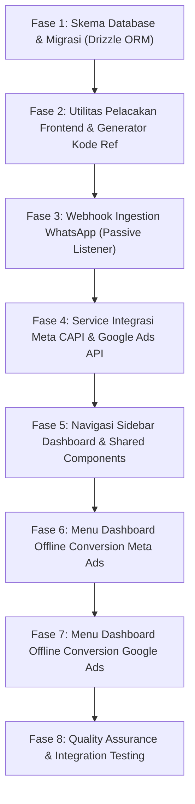

# Breakdown Task Implementasi: Offline Conversion Meta Ads & Google Ads

Dokumen ini memecah [plan-offline-conversion-meta-google-ads.md](file:///Users/ahmadkhairolmaulidi/Documents/Freelance/marketingcodeid-agency/project/docs/plan-offline-conversion-meta-google-ads.md) menjadi unit tugas (*tasks*) kecil, terstruktur, dan berurutan agar dapat dieksekusi secara bertahap oleh AI agent tanpa risiko regresi atau konflik arsitektur.

---

## Ringkasan Alur Eksekusi Antar Fase

---

## Fase 1: Skema Database & Migrasi (Drizzle ORM & PostgreSQL)

Tujuan: Membangun tabel database PostgreSQL untuk menyimpan sesi klik, data konversi offline, log transmisi API, dan kredensial platform iklan.

- [x] **Task 1.1: Definisi Tabel Baru di Skema Drizzle**
  - **Target File:** [src/db/schema.ts](file:///Users/ahmadkhairolmaulidi/Documents/Freelance/marketingcodeid-agency/project/src/db/schema.ts)
  - **Spesifikasi:**
    - Tambahkan tabel `adClickSessions` dengan kolom: `id` (uuid pk), `refCode` (varchar 20, unique, indexed), `sourceUrl` (text), `gclid` (text, nullable), `wbraid` (text, nullable), `gbraid` (text, nullable), `fbclid` (text, nullable), `fbc` (text, nullable), `fbp` (text, nullable), `ipAddress` (varchar 45, nullable), `userAgent` (text, nullable), `phoneNumber` (varchar 30, nullable), `phoneHash` (text, nullable), `status` (varchar 20, default `'CLICKED'`), `createdAt` (timestamp with tz), `updatedAt` (timestamp with tz).
    - Tambahkan tabel `offlineConversions` dengan kolom: `id` (uuid pk), `sessionId` (uuid references `adClickSessions.id`), `platform` (varchar 20 - `'META'`, `'GOOGLE'`, `'BOTH'`), `eventName` (varchar 50), `conversionValue` (numeric 15,2), `currency` (varchar 10, default `'IDR'`), `conversionTime` (timestamp with tz), `createdBy` (uuid references `users.id`), `createdAt` (timestamp with tz).
    - Tambahkan tabel `conversionApiLogs` dengan kolom: `id` (uuid pk), `conversionId` (uuid references `offlineConversions.id`, nullable), `platform` (varchar 20), `endpoint` (text), `requestPayload` (jsonb), `responseStatus` (integer), `responsePayload` (jsonb), `isSuccess` (boolean), `errorMessage` (text, nullable), `createdAt` (timestamp with tz).
    - Tambahkan tabel `adPlatformConfigs` dengan kolom: `id` (uuid pk), `platform` (varchar 20, unique), `credentialsEncrypted` (jsonb), `isActive` (boolean, default true), `updatedAt` (timestamp with tz).
  - **Acceptance Criteria:** Skema TypeScript valid, bebas lint error, dan relasi foreign key terdefinisi benar.

- [x] **Task 1.2: Ekspor Tipe Data TypeScript Terpusat**
  - **Target File:** `src/types/offline-conversion.ts`
  - **Spesifikasi:**
    - Ekspor TypeScript `type` dan `interface` untuk inferensi Drizzle: `AdClickSessionRow`, `NewAdClickSession`, `OfflineConversionRow`, `NewOfflineConversion`, `ConversionApiLogRow`, `AdPlatformConfigRow`.
    - Ekspor status enum types: `SessionStatus = 'CLICKED' | 'LEAD_RECEIVED' | 'WON' | 'LOST'`.
    - Ekspor payload DTO untuk Meta CAPI dan Google Ads Conversion.
  - **Acceptance Criteria:** Tipe data dapat diimpor tanpa siklus dependensi (*circular dependency*).

- [x] **Task 1.3: Eksekusi Migrasi Database Drizzle Kit**
  - **Target Perintah:** `pnpm drizzle-kit generate` dan `pnpm drizzle-kit push` (atau script migrasi lokal).
  - **Spesifikasi:**
    - Generate file migrasi SQL baru di direktori migrasi project.
    - Jalankan sinkronisasi skema ke database PostgreSQL.
  - **Acceptance Criteria:** Perintah exit dengan code 0, tabel terverifikasi ada di database, `pnpm build` tetap lolos.

---

## Fase 2: Utilitas Pelacakan Frontend & Generator Kode Referensi

Tujuan: Menangkap parameter iklan saat pengguna mendarat di website, menghasilkan kode referensi pendek, dan menyimpannya sebelum mengarahkan ke WhatsApp.

- [x] **Task 2.1: Modul Utilitas Ekstraksi Parameter Iklan & Cookies**
  - **Target File:** `src/lib/tracking/ad-params.ts`
  - **Spesifikasi:**
    - Buat fungsi `extractAdParams(searchParams, cookies)` untuk membaca: `gclid`, `wbraid`, `gbraid`, `fbclid`, cookie `_fbp`, dan cookie `_fbc`.
    - Buat fungsi pembentuk format standar Meta `fbc`: `formatMetaFbc(fbclid: string, timestamp?: number): string` menghasilkan string `fb.1.${timestamp}.${fbclid}` jika cookie `_fbc` belum ada dari browser.
  - **Acceptance Criteria:** Fungsi memiliki unit test murni yang memvalidasi parsing berbagai variasi URL query string dan cookie.

- [x] **Task 2.2: Modul Pembuat Kode Referensi Pendek Acak (Ref Code)**
  - **Target File:** `src/lib/tracking/ref-code.ts`
  - **Spesifikasi:**
    - Buat fungsi `generateRefCode(prefix = 'MC'): string` yang menghasilkan format `#MC-XXXX` (4 karakter alfanumerik kapital acak yang mudah dibaca, menghindari karakter ambigu seperti 0/O, 1/I/L).
    - Pastikan fungsi menghasilkan string dengan panjang yang konsisten (contoh: `#MC-8K2A`).
  - **Acceptance Criteria:** Ref code unik, ringkas, dan aman disisipkan ke dalam teks pesan WhatsApp tanpa membuat pesan terlalu panjang.

- [x] **Task 2.3: API Route Pencatat Klik WhatsApp**
  - **Target File:** `src/app/api/ad-tracking/click/route.ts`
  - **Spesifikasi:**
    - Endpoint HTTP POST yang menerima payload: `sourceUrl`, `searchParams`, cookie `_fbp`, `_fbc`.
    - Mengambil IP Address (via header `x-forwarded-for`) dan User-Agent (via header `user-agent`).
    - Generate `refCode`, simpan baris baru ke tabel `adClickSessions` dengan status `CLICKED`.
    - Mengembalikan respons JSON berisi `{ refCode, sessionId }`.
  - **Acceptance Criteria:** Menyimpan sesi dengan aman, menangani kegagalan database secara elegan tanpa menghalangi navigasi user ke WhatsApp.

- [x] **Task 2.4: Integrasi Tombol WhatsApp Frontend di Landing Page**
  - **Target File:** `src/components/whatsapp-link.tsx` atau komponen CTA terkait di `src/components/home/` dan halaman layanan.
  - **Spesifikasi:**
    - Perbarui *event handler* tombol WhatsApp: sebelum redirect ke `wa.me`, kirim request asinkron ke `/api/ad-tracking/click`.
    - Tambahkan kode referensi ke teks pesan pembuka WhatsApp: `"Halo Admin MarketingCode.ID, saya ingin konsultasi layanan (Ref: #MC-XXXX)"`.
    - Jika request tracking timeout atau gagal (maksimal 300ms), fallback langsung buka WhatsApp dengan teks umum agar kenyamanan pengguna tidak terganggu.
  - **Acceptance Criteria:** Tombol WhatsApp menghasilkan tautan yang memuat kode referensi, dan sesi klik tersimpan di tabel database.

---

## Fase 3: Webhook Ingestion WhatsApp (Passive Listener)

Tujuan: Menerima payload pesan masuk dari gateway WhatsApp Unofficial (misal WAHA) secara pasif, mengekstrak kode referensi, dan memperbarui status prospek.

- [x] **Task 3.1: API Route Webhook Ingestion WhatsApp yang Terotentikasi**
  - **Target File:** `src/app/api/webhooks/whatsapp/route.ts`
  - **Spesifikasi:**
    - Proteksi endpoint dengan verifikasi header `x-webhook-secret` terhadap env `WHATSAPP_WEBHOOK_SECRET`.
    - Menerima event pesan masuk (`message.received` / `messages.upsert`).
    - Verifikasi payload bukan pesan keluar (*fromMe === false*) untuk mencegah loop rekursif.
  - **Acceptance Criteria:** Request tanpa secret yang valid ditolak dengan HTTP 401/403. Request valid menghasilkan HTTP 200 OK secara instan (< 200ms).

- [x] **Task 3.2: Parser Teks Pesan & Ekstraktor Nomor Telepon E.164**
  - **Target File:** `src/lib/tracking/whatsapp-parser.ts`
  - **Spesifikasi:**
    - Buat fungsi `extractRefCodeFromMessage(messageText: string): string | null` menggunakan ekspresi reguler `/Ref:\s*#(MC-[A-Z0-9]{4,6})/i`.
    - Buat fungsi `normalizePhoneNumberE164(rawPhone: string): string` yang mengonversi format lokal (contoh: `08123456789`) atau format internasional (contoh: `628123456789@c.us`) menjadi format standar internasional `+628123456789`.
  - **Acceptance Criteria:** Regex akurat mengekstrak kode referensi meskipun ada tambahan teks lain dari calon pembeli.

- [x] **Task 3.3: Database Matcher & Status Updater**
  - **Target File:** `src/lib/tracking/session-updater.ts`
  - **Spesifikasi:**
    - Cari baris `adClickSessions` yang cocok dengan `refCode`.
    - Hitung hash SHA-256 dari nomor telepon ternormalisasi.
    - Update `phoneNumber`, `phoneHash`, dan ubah `status` menjadi `'LEAD_RECEIVED'`.
    - Jika sesi ditemukan dan memiliki parameter `fbclid`/`fbc`, (opsional) buat trigger otomatis log event `Lead` ke Meta CAPI.
  - **Acceptance Criteria:** Baris sesi terupdate dengan nomor HP pengirim secara tepat, log transparan tercatat jika kode referensi tidak ditemukan.

---

## Fase 4: Service Integrasi Meta CAPI & Google Ads API

Tujuan: Membangun modul backend untuk normalisasi PII, penembakan event ke Meta Graph API (CAPI), dan upload konversi ke Google Ads.

- [x] **Task 4.1: Utilitas Hashing & Normalisasi PII Sesuai Standar Iklan**
  - **Target File:** `src/lib/tracking/hashing.ts`
  - **Spesifikasi:**
    - Buat fungsi `hashSha256(input: string): string` menggunakan modul bawaan Node.js `crypto`.
    - Pastikan input selalu di-trim dan di-lowercase sebelum di-hash sesuai ketentuan Meta dan Google.
  - **Acceptance Criteria:** Hasil hash sesuai dengan vektor uji standar SHA-256 (misal: verifikasi dengan string acak yang diketahui hasil hash-nya).

- [x] **Task 4.2: Client Service Meta Conversions API (CAPI)**
  - **Target File:** `src/lib/integrations/meta-capi.ts`
  - **Spesifikasi:**
    - Endpoint: `https://graph.facebook.com/v19.0/{PIXEL_ID}/events`.
    - Fungsi `sendMetaCapiEvent(params)`:
      - Parameter payload: `eventName` (`'Lead'` atau `'Purchase'`), `eventTime`, `actionSource: 'website'`, `userData` (`fbc`, `fbp`, `client_ip_address`, `client_user_agent`, `ph` [hashed]), `customData` (`value`, `currency: 'IDR'`).
      - Dukungan parameter `test_event_code` untuk debugging live di Meta Events Manager.
      - Catat setiap request dan response status ke tabel `conversionApiLogs`.
  - **Acceptance Criteria:** Payload valid sesuai skema Meta Conversions API v19.0+, error HTTP ditangani tanpa melempar unhandled promise rejection.

- [x] **Task 4.3: Client Service Google Ads Offline Conversion**
  - **Target File:** `src/lib/integrations/google-ads.ts`
  - **Spesifikasi:**
    - Fungsi `sendGoogleOfflineConversion(params)`:
      - Mendukung upload konversi berbasis `gclid`, `wbraid`, atau `gbraid`.
      - Mendukung Enhanced Conversions for Leads (menyertakan nomor telepon berformat E.164 yang di-hash SHA-256).
      - Parameter nilai transaksi (`conversion_value`) dan mata uang (`currency_code: 'IDR'`).
      - Simpan status dan ID konversi ke tabel `conversionApiLogs`.
  - **Acceptance Criteria:** Terintegrasi dengan format payload Google Ads REST API v17+ / ClickConversionService.

- [x] **Task 4.4: Generator Ekspor CSV Cadangan Resmi Google Ads Data Manager**
  - **Target File:** `src/lib/integrations/google-csv-export.ts`
  - **Spesifikasi:**
    - Fungsi `generateGoogleAdsConversionCsv(conversions)` menghasilkan format CSV standar Google:
      `Parameters: Google Click ID, Conversion Name, Conversion Time, Conversion Value, Conversion Currency`
      diikuti oleh baris data transaksi.
    - Format tanggal wajib sesuai spesifikasi Google: `yyyy-mm-dd hh:mm:ss+zz:zz`.
  - **Acceptance Criteria:** File CSV dapat diimpor langsung ke menu Uploads pada Google Ads tanpa error format header atau tanggal.

---

## Fase 5: Navigasi Sidebar Dashboard & Shared Components

Tujuan: Menyediakan integrasi menu baru pada antarmuka dashboard dan komponen visual pendukung (tabel, kartu statistik, badge status).

- [x] **Task 5.1: Pembaruan Navigasi Sidebar Dashboard**
  - **Target File:** [src/components/dashboard/sidebar-nav.tsx](file:///Users/ahmadkhairolmaulidi/Documents/Freelance/marketingcodeid-agency/project/src/components/dashboard/sidebar-nav.tsx) dan `src/components/dashboard/MobileSidebar.tsx`
  - **Spesifikasi:**
    - Tambahkan kategori menu baru: `OFFLINE CONVERSION`.
    - Tambahkan item:
      1. `Meta Ads Conversion` menuju `/dashboard/offline-conversion/meta` dengan icon Lucide `Target`.
      2. `Google Ads Conversion` menuju `/dashboard/offline-conversion/google` dengan icon Lucide `TrendingUp`.
    - Pastikan styling konsisten dengan item menu lain (active indicator, typography, spacing, strict tanpa emoji).
  - **Acceptance Criteria:** Menu tampil rapi pada sidebar desktop dan mobile drawer, navigasi aktif menyala sesuai rute saat ini.

- [x] **Task 5.2: Shared UI Components untuk Modul Offline Conversion**
  - **Target File:** Direktori `src/components/dashboard/offline-conversion/`
  - **Spesifikasi:**
    - `ConversionStatCard.tsx`: Kartu ringkasan metrik (angka, label, persentase tren, icon).
    - `ConversionStatusBadge.tsx`: Badge status visual (`CLICKED` = zinc, `LEAD_RECEIVED` = blue, `WON` = emerald, `LOST` = rose).
    - `MaskedPhoneCell.tsx`: Menampilkan nomor telepon dengan format sensor tengah demi privasi (contoh: `+62 812-****-7890`).
    - `DateRangeFilter.tsx`: Dropdown pemilih rentang tanggal (Hari Ini, 7 Hari Terakhir, 30 Hari Terakhir, Bulan Ini).
  - **Acceptance Criteria:** Komponen modular, responsive, mendukung mode dark/light sesuai tema aplikasi.

---

## Fase 6: Menu Dashboard Offline Conversion Meta Ads

Tujuan: Membangun antarmuka lengkap untuk memantau, memvalidasi, memicu konversi closing, dan mengatur kredensial Meta Ads CAPI.

- [x] **Task 6.1: Server Actions Modul Meta Ads Offline Conversion**
  - **Target File:** `src/app/(dashboard)/dashboard/(main)/offline-conversion/meta/actions.ts`
  - **Spesifikasi:**
    - `getMetaConversionListAction(filters)`: Query daftar sesi klik yang memiliki parameter `fbclid`/`fbc`, status, dan log CAPI.
    - `markLeadClosingAction(formData)`: Mengubah status lead menjadi `WON`, mencatat nominal transaksi, dan memanggil `sendMetaCapiEvent` untuk event `Purchase`.
    - `retryMetaCapiEventAction(conversionId)`: Memicu ulang pengiriman CAPI yang gagal.
    - `saveMetaConfigAction(formData)`: Menyimpan Pixel ID, Dataset ID, dan Token System User ke tabel `adPlatformConfigs`.
  - **Acceptance Criteria:** Semua action diproteksi fungsi `requireAdmin()`, memvalidasi input via Zod, dan merevalidasi cache halaman.

- [x] **Task 6.2: Halaman Utama Ringkasan & Tabel Riwayat Meta Ads**
  - **Target File:** `src/app/(dashboard)/dashboard/(main)/offline-conversion/meta/page.tsx`
  - **Spesifikasi:**
    - Menampilkan kartu ringkasan: Total Klik Meta, Lead WA Masuk, Closing Purchase Terkirim, Estimasi Event Match Quality (EMQ).
    - Tabel interaktif memuat kolom: Tanggal Klik, Kode Ref, Nomor WA (Masked), Nilai Closing, Parameter `fbc`/`fbp`, Status CAPI, dan Tombol Aksi.
  - **Acceptance Criteria:** Data dimuat secara server-side dengan cepat, responsif di resolusi desktop dan tablet.

- [x] **Task 6.3: Modal / Form Trigger Closing Prospek Meta**
  - **Target File:** `src/components/dashboard/offline-conversion/TriggerClosingModal.tsx`
  - **Spesifikasi:**
    - Modal popup untuk menandai transaksi closing: input nominal transaksi (IDR), tanggal transaksi, dan catatan opsional.
    - Menampilkan preview data yang akan dikirim ke Meta CAPI (`fbc`, `fbp`, nomor HP hashed).
    - Tombol konfirmasi yang memanggil `markLeadClosingAction`.
  - **Acceptance Criteria:** Form memiliki validasi nominal > 0, status loading saat submit, dan feedback toast Sonner yang jelas.

- [x] **Task 6.4: Halaman Pengaturan Kredensial Meta Ads CAPI**
  - **Target File:** `src/app/(dashboard)/dashboard/(main)/offline-conversion/meta/settings/page.tsx`
  - **Spesifikasi:**
    - Input form: Meta Pixel ID / Dataset ID, System User Access Token (password-type input), Test Event Code.
    - Tombol `Kirim Test Event`: Menguji koneksi langsung ke Meta Graph API dan menampilkan respons status HTTP secara real-time.
  - **Acceptance Criteria:** Token tersimpan aman, pengujian koneksi berhasil memverifikasi status token langsung ke server Meta.

---

## Fase 7: Menu Dashboard Offline Conversion Google Ads

Tujuan: Membangun antarmuka lengkap untuk memantau GCLID, mengunggah konversi offline, mengekspor template CSV, dan mengatur kredensial Google Ads.

- [x] **Task 7.1: Server Actions Modul Google Ads Offline Conversion**
  - **Target File:** `src/app/(dashboard)/dashboard/(main)/offline-conversion/google/actions.ts`
  - **Spesifikasi:**
    - `getGoogleConversionListAction(filters)`: Query daftar sesi klik yang memiliki `gclid`/`wbraid`/`gbraid`.
    - `uploadGoogleConversionAction(formData)`: Memvalidasi dan mengirimkan konversi offline closing ke Google Ads API.
    - `exportGoogleCsvAction(filters)`: Menghasilkan string file CSV standar Google Ads untuk diunduh user.
    - `saveGoogleConfigAction(formData)`: Menyimpan Customer ID, Conversion Action Name, dan OAuth2 credentials.
  - **Acceptance Criteria:** Memvalidasi hak akses admin, validasi skema form via Zod, dan penanganan error komprehensif.

- [x] **Task 7.2: Halaman Utama Ringkasan & Tabel Riwayat Google Ads**
  - **Target File:** `src/app/(dashboard)/dashboard/(main)/offline-conversion/google/page.tsx`
  - **Spesifikasi:**
    - Kartu ringkasan: Total GCLID Tertangkap, Total Konversi Terunggah, Nilai Revenue Tercatat, Status Enhanced Conversions.
    - Tabel memuat kolom: Tanggal Klik, GCLID (snippet dipotong dengan copy-to-clipboard), Nomor WA (Masked), Nilai Transaksi, Status Upload, dan Aksi.
    - Tombol Header: `Ekspor CSV Google Ads` dan `Pengaturan Kredensial`.
  - **Acceptance Criteria:** Tabel mendukung paginasi dan filter rentang waktu.

- [x] **Task 7.3: Fitur Download File CSV Resmi Google Ads Offline Upload**
  - **Target File:** `src/app/api/offline-conversion/google/export-csv/route.ts`
  - **Spesifikasi:**
    - Endpoint download file dengan header `Content-Type: text/csv` dan `Content-Disposition: attachment; filename="google-offline-conversions-{date}.csv"`.
    - Hanya memuat baris berstatus closing (`WON`) yang memiliki parameter klik Google yang valid.
  - **Acceptance Criteria:** File CSV dapat langsung diunggah di menu Google Ads Dashboard tanpa formatting error.

- [x] **Task 7.4: Halaman Pengaturan Kredensial Google Ads API**
  - **Target File:** `src/app/(dashboard)/dashboard/(main)/offline-conversion/google/settings/page.tsx`
  - **Spesifikasi:**
    - Form konfigurasi: Google Ads Customer ID (format `xxx-xxx-xxxx`), Conversion Action Name, Developer Token, OAuth2 Client ID & Secret, Refresh Token.
    - Panduan ringkas langkah pembuatan Conversion Action di Google Ads Data Manager.
  - **Acceptance Criteria:** Form menyimpan konfigurasi terenkripsi ke tabel `adPlatformConfigs`.

---

## Fase 8: Quality Assurance, Integration Testing, & Audit Gate

Tujuan: Memastikan seluruh fungsionalitas baru bebas dari celah keamanan, lulus protokol pengetesan proyek, dan memiliki performa optimal.

- [x] **Task 8.1: Pembuatan Automated Integration Tests**
  - **Target File:** `tests/int/offline-conversion.int.spec.ts`
  - **Spesifikasi:**
    - Test suite mencakup:
      1. Ekstraksi parameter iklan dan pembentukan string `fbc`.
      2. Hashing SHA-256 nomor telepon E.164.
      3. Regex parser ekstraksi kode referensi WhatsApp.
      4. Webhook handler: validasi secret otorisasi dan update status sesi.
      5. Penyusunan payload Meta CAPI `Purchase` dan Google Click Conversion.
  - **Acceptance Criteria:** Seluruh pengujian pada file test baru lulus 100%.

- [x] **Task 8.2: Build Validation & Full Test Suite Pass**
  - **Target Perintah:** `pnpm test:int` dan `pnpm build`
  - **Spesifikasi:**
    - Jalankan seluruh 85+ test integrasi yang sudah ada ditambah test baru.
    - Jalankan build Next.js produksi dengan Turbopack.
  - **Acceptance Criteria:** Seluruh test integrasi lulus 100% (exit code 0), build kompilasi TypeScript dan page generator selesai dengan exit code 0.

- [x] **Task 8.3: Agentic Browsing & Visual UX Verification**
  - **Target:** Pengujian browser pada mode Desktop (1280x800) dan Mobile (390x844).
  - **Spesifikasi:**
    - Verifikasi navigasi sidebar menu baru: `/dashboard/offline-conversion/meta` dan `/dashboard/offline-conversion/google`.
    - Pastikan layout tabel responsive, tidak ada overflow horizontal yang merusak tampilan.
    - Pastikan aturan mutlak tanpa emoji (*Strict No-Emoji Rule*) terpenuhi 100% pada seluruh label teks, badge, tombol, dan header.
  - **Acceptance Criteria:** Tampilan rapi, profesional, konsisten dengan gaya desain dark/light mode dashboard MarketingCode.ID.
